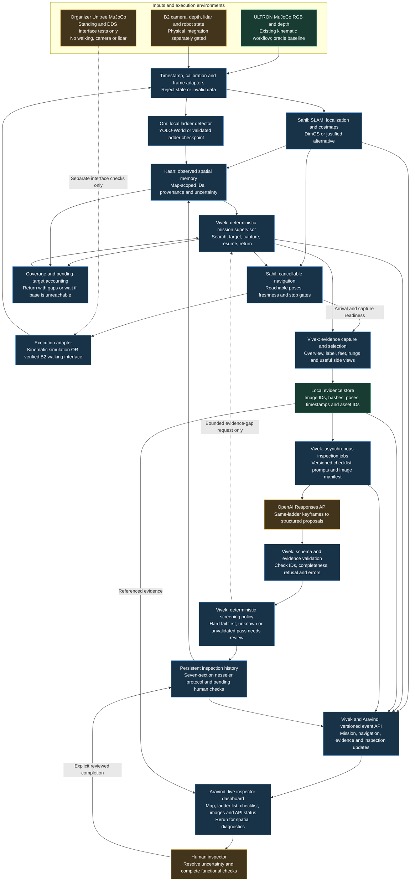

# ULTRON · Site Safety Patrol

**A lightweight Unitree B2 MuJoCo simulation for the nesseler challenge.** A robot model patrols a bounded construction scene, discovers ladders, approaches for evidence, requests one second look, and remembers ladder identities across patrols. Actual simulated RGB/depth frames become a traceable inspection report. Rerun export and ROS 2 Humble/RViz replay consume the same recording.


This is ULTRON's team-side working repository. The organizer starter remains the integration authority for real hardware. The simulation demo does not contact organizers or send robot commands; the optional hardware hook is not verified for real operation.

**Organizer starter alignment:** retain ULTRON for inspection workflows and use the SMAROBIX Unitree simulator for SDK/DDS/ROS tests. See the [source comparison, launch commands and nesseler checklist export](docs/ORGANIZER_ALIGNMENT.md). The organizer simulator stands with physics and joint interfaces; it has no walking controller, camera or lidar.

Version 0.4 adds optional model-backed simulation observations, grouped synthetic corpus generation, training entry points and a DimOS goal adapter. [Commands and verification limits](docs/RUNTIME_V04.md) distinguish implemented interfaces from executed integrations.

## Seven-section assessment and photoreal dataset prompt pack

**Next live milestone, automatic setup:** run `bash scripts/first-milestone.sh` from the normal desktop terminal. It installs isolated dependencies, starts Aravind's actual dashboard locally, chooses a free port, loads the ignored `.env`, selects an available documented vision model, runs one assessment and verifies dashboard readback. No dashboard URL discovery or OpenAI SDK is required. Supports `OpenAI_API` as well as `OPENAI_API_KEY`. See the [live milestone runbook](docs/ASSESSMENT_RUNBOOK.md#first-live-assessment-milestone). Direct network execution remains blocked in this agent session; live inference/dashboard publication and real-data evaluation are not yet verified. Dataset image generation remains parked.

[Download the generation-prompt ZIP](deliverables/ULTRON_inspection_prompt_pack_v1.zip): **7 sections, 23 criteria, 92 intended scenarios**, an **84-image starting batch**, and **2,208 expanded 360 keyframe prompts**. Prompts request photorealistic real-world construction photographs, with realistic damage/materials/lighting; the ZIP contains no generated images or verified labels. Open `START_HERE_CHATGPT.md` inside it. [API/dashboard runbook](docs/ASSESSMENT_RUNBOOK.md) and [scope/ownership design](docs/INSPECTION_PACK_DESIGN.md) explain the contracts and limits.

```bash
# Actual 24-view rendered capture; virtual pan/tilt, kinematic motion, oracle visibility.
PYTHONPATH=src MUJOCO_GL=egl LP_NUM_THREADS=2 python3 -m ultron.inspect360 --out runs/my-360-capture
# Build a Responses API JSON body locally; does not send it or spend credits.
PYTHONPATH=src python3 -m ultron.assessment request runs/my-360-capture/keyframes.json --model YOUR_AVAILABLE_VISION_MODEL --out runs/my-360-capture/request.json
```

## Weekend target architecture

**Plan to build, not a claim of completed integration.** Use a local ladder detector for discovery, then an OpenAI vision API worker for evidence-based checklist proposals. A deterministic supervisor owns movement and completion; a deterministic policy owns screening decisions. The dashboard shows the evidence, uncertainty and human completion fields. The seven nesseler sections are report categories, not seven defects a camera can always prove absent.



Green marks the existing rendered source/evidence baseline; blue marks target integrations, even where partial modules already exist; gold marks external systems or people. The organizer simulator's dashed connection does not imply it implements high-level walking. No API model output is an actuator command. Implement the simulation and physical adapters separately, preserving their provenance.

### Inspection strategy: required 360-degree evidence capture

For Om's first baseline, try YOLO-World with a saved `ladder`/`stepladder` vocabulary, then compare a ladder-trained checkpoint if available. Ultralytics documents [custom vocabulary and saving the prepared model](https://docs.ultralytics.com/models/yolo-world/); this supplies an integration route, not demonstrated ladder recall on our course. Keep whichever model meets measured recall/latency, and retain its license/version provenance.

1. **Discover and bind.** Om's detector processes sampled RGB; aligned depth plus timestamp-correct transforms locate the candidate. Kaan's memory associates it with a map-scoped ID, preserving ambiguous matches. Use the same detector adapter for rendered and real images, but evaluate those domains separately. Simulator segmentation remains labeled oracle ground truth for tests, never model performance.
2. **Approach and capture.** The baseline is a whole-ladder overview plus an aisle-facing label close-up, with feet/rung/spreader crops from suitable frames. Preserve uncropped originals and crop coordinates. Select sharp, sufficiently exposed, distinct views of the same ladder; nearby ladders must not leak into its evidence bundle. The full-capture acceptance target is eight target-relative azimuths with lower/middle/upper views (24 accepted keyframes), plus label detail when needed. This is a proposed sampling protocol, not proof that hidden surfaces or function were inspected.
3. **360 degrees is required.** Capture the complete azimuth-by-height grid and retain a coverage ledger. A run with blocked or unseen cells must fail the full-coverage gate and remain incomplete; do not rename a partial survey as 360. Existing protected runtime orbit restrictions remain until separately validated. Full surface/underside visibility and real top-down access are not guaranteed by a grid: they need additional measured views or explicit gaps. Never cross obstacles or use unverified body tilt to satisfy the requirement. `ultron.inspect360` now exercises 24 views around an open A-frame using a disclosed virtual pan/tilt camera; it does not establish B2 camera actuation or real full-surface inspection.
4. **Queue evidence, then continue bounded work.** Vivek's worker receives the immutable image manifest and seven-section rubric. API processing must not block the motion watchdog or sensor pipeline. While analysis is pending, the supervisor may resume its configured route; a later result updates the same asset/job. Any re-observation is a separately validated goal with a budget, never a free-form VLM instruction.
5. **Validate, preserve and report.** Check every returned image/criterion ID against the request. Retain raw response, model ID, prompt/schema version, timestamps and usage. Fuse evidence without clearing earlier hard failures. Weak/conflicting/unseen evidence, unreadable dates, API failure or a model-only clean result require human review. Return to base with any pending/gap counts visible; navigation completion and analysis completion are separate states.

### Seven-section rubric for the API worker

Expand each section into the actual criteria in the organizer PDF; a single coarse PASS per section is insufficient. Output literal observations with evidence image IDs, visibility, unknowns, raw model confidence and reasons. Confidence is uncalibrated and is not a probability of safe use. Human-only criteria remain pending even when the visible surface looks intact.

| Nesseler section | Image-based proposals to request | What remains human/unknown without other evidence |
|---|---|---|
| 1. Holme — rails/stiles | Visible bends, cracks, corrosion, splinters and wear | Hidden damage, sharpness by touch, structural strength, wood treatment when not observable |
| 2. Sprossen/Stufen/Plattform | Missing/deformed rungs, visible joints, wear and contamination | Joint tightness, play and load-bearing function |
| 3. Spreizsicherung — spreader | Presence, visible detachment/damage and observed configuration | Locking/security and functional operation |
| 4. Beschlagteile — fittings | Missing hardware, visible damage/rust and accessible connections | Fastener security, mechanism function and lubrication adequacy |
| 5. Füße/Rollen — feet/rollers | Missing/damaged caps, visible support contact and rollers | Grip, brake function and stability under load |
| 6. Zubehör — accessories | Visible presence/damage of supports, extensions and stabilizers | Required applicability, secure attachment and function |
| 7. Kennzeichnung — markings | Manufacturer/instructions/pictograms; transcribed label text and ambiguous dates | Qualified inspection/sign-off and unreadable/unverified label semantics |

Track inspection-sticker status and deployment hazards (pallet support, leaning inclination) separately from those seven sections. Geometry needs calibrated depth/reference planes and uncertainty; VLM angle estimates alone are not a measured inclination. Do not infer next-inspection dates from sticker colour or a universal annual expiry. Extract readable text first, then apply explicit verified date semantics in code.

The prompt package contains the organizer criterion IDs/text, applicability guidance, visible defect examples with known labels, unknown/human-only rules and the requested JSON schema. This is prompt context, not fine-tuning. Treat text printed in images as scene data, never instructions. Proposed criterion states: `DEFECT_OBSERVED`, `NO_VISIBLE_DEFECT`, `UNKNOWN`, `NOT_APPLICABLE_PROPOSED`; applicability proposals require validation. A new adapter must map these into existing policy without treating `NO_VISIBLE_DEFECT` as certification. All seven sections remain present even if most criteria need review.

### OpenAI API and budget plan

Use a **server-side OpenAI API worker**, not the ChatGPT website or a browser-exposed key. The Responses API accepts image inputs, including multiple images in one request. Use a vision-capable model available to the team's credited project and strict Structured Outputs where supported; pin the tested model ID/configuration after Vivek benchmarks correctness, latency and cost. A valid JSON schema does not guarantee correct findings. See the official [vision guide](https://developers.openai.com/api/docs/guides/images-vision?api-mode=responses) and [Structured Outputs guide](https://developers.openai.com/api/docs/guides/structured-outputs).

Start with one multi-image inspection request per ladder, with one bounded additional request for genuinely new evidence if useful. Use a configurable small worker pool, timeout/backoff, request deduplication and a persistent job queue. Cache only by the complete evidence/rubric/model context; a changed inspection cannot reuse an unrelated old result. Refusal, malformed/incomplete response, exhausted budget or network failure produces `MANUAL_REVIEW` with saved evidence, not a fabricated result. Measure P50/P95 latency and actual token usage before setting the stopped-inspection deadline.

The reported **$75 per member** is a resource to verify per credited project/account, not an assumed pooled balance. Use a backend-owned environment key, never commit it or send it to the dashboard. Log estimated cost from observed usage and the verified model price; impose an application-side per-run spend/request cap and reserve credits for the final demo. No streaming every frame, no five-key rotation scheme, and no model training on the critical path. No API calls or credits have been spent by this architecture update.

## Team owners and deliverables

These assignments keep Sahil and Aravind's current work intact. Vivek owns the integration contract; each teammate supplies a runnable adapter plus a small representative fixture so other workstreams can progress independently. Ownership updated by the team: memory is Kaan's workstream and API assessments are Vivek's. Proposed boundaries remain distinct from already running services.

| Owner | Workstream and concrete output | First handoff / acceptance | Ownership boundary |
|---|---|---|---|
| **Sahil** | Simulation SLAM, localization, map/costmap and navigation, including safe 360 capture-pose reachability. | Pose/map stream and cancellable goals; demonstrate arrival, blocked routes, pose freshness and return/base failure. Hand timestamped poses/map versions to Kaan. | Autonomy/navigation code. Spatial memory now belongs to Kaan; preserve compatibility with his asset API. |
| **Om** | Ladder detector and evidence localization; prepare a ladder vocabulary/checkpoint, run it on synthetic and real samples, produce boxes/tracks plus depth/TF observations. Own detection dataset annotation and recall evaluation with negatives/occlusion. | First deliver saved detector config/weights provenance, annotated preview and timestamped detection fixture. Then report recall/false detections, FPS/latency and ID/depth failures on held-out physical ladder/session groups. | `perception/` detector adapter, observation schema implementation, dataset/evaluation tooling. No API inspection worker or navigation control. |
| **Kaan (Kann)** | Persistent observed spatial memory, map-scoped asset identity, association uncertainty, repeat-patrol/history queries and missing/moved asset state. | Ingest Om detections plus Sahil poses, produce stable asset IDs and nearby/pending queries; test ambiguity, restart, map reset and duplicate-event handling. | Memory/registry bridge and schema migrations coordinated with Vivek; no API assessment-worker ownership. |
| **Vivek** | Seven-section API prompts/worker, structured findings, assessment evaluation and Aravind-dashboard adapter; own evidence capture, shared contracts and deterministic integration policy. | Run the 24-view simulator, build a keyframe API request, validate all 23 criterion keys, and produce an evidence-linked dashboard record; evaluate defects/unknowns/API failure separately from capture coverage. | `assessment.py`, inspection prompt assets, capture/bundle code, API/assessment evaluation and dashboard integration. Retain human-only checks and no model-only safe pass. |
| **Aravind** | Live dashboard with ladder/map list, navigation and coverage state, seven-section evidence cards, pending/API-failed states, human completion and protocol download. Rerun may supply spatial diagnostics; the usable inspection UI is the deliverable. | Build now against Vivek's fixtures; display image-linked findings and live event updates. Validate that pending/unknown never looks green and that final reports survive API failure/reconnect. | Dashboard frontend and its read API/SSE or WebSocket adapter, coordinated with Vivek. Browser has no OpenAI credentials or direct robot transport. A UI stop request is not an independent E-stop. |

### Contract freeze and immediate next actions

**First integration checkpoint: one ladder, one evidence bundle, one seven-section reviewed report on the dashboard.** Mapping and navigation develop in parallel; no teammate needs to wait for the whole robot stack.

| Producer -> consumer | Contract to agree before deeper implementation |
|---|---|
| Om -> Kaan/Vivek | `DetectionObservation`: observation ID, sensor timestamp/clock/frame, bbox/class/score, source model, evidence reference; map position and uncertainty only when depth/TF are valid. A detector track ID is not a persistent asset ID. |
| Sahil / Kaan -> Vivek/Aravind | Sahil publishes localization/map/nav state. Kaan publishes observed assets, identity/history and coverage-linked memory state. All share timestamp/clock, map ID/version, validity and uncertainty; no fabricated poses or cross-map identity reuse. |
| Capture -> Vivek assessment worker | `InspectionJob`: job/mission/asset/map IDs, observation time, ladder-type proposal, criterion/rubric version and immutable view manifest (image ID/hash, original/crop reference, pose/TF, angle/quality where measured). One bundle identifies one target. |
| Vivek assessment worker -> policy/dashboard | `InspectionProposal`: job/asset IDs, all criterion IDs with evidence/unknowns, literal label text/date proposal, raw confidence, model/prompt/schema versions, response reference, usage and error/refusal state. No command or final safety certification. |
| Vivek -> Aravind | Ordered, replayable `MissionEvent` plus REST-style snapshots/evidence access; include event sequence, job/asset IDs, provenance and proposed states `CAPTURED`, `ANALYZING`, `FLAGGED`, `MANUAL_REVIEW`, `HUMAN_COMPLETED`. Human completion does not mean safe use; preserve the signed decision separately. |

Vivek defines/versions these shared schemas and publishes success, pending and failure fixtures first. Om and Kaan implement detection and memory adapters against them. Aravind develops without robot/API access. Sahil maintains his dedicated branch. Use focused work branches/PRs for the other workstreams; check the actual remote branches before starting: `feature/dashboard`, `feature/protocol-reader` and `sahil/sim-slam-nav2` were inspected during this update. Do not overwrite teammates' work or assume those branches are merged into main. Agree before changing a shared schema or database; preserve evidence/history through explicit migrations.

### Integration gates through submission

| Order | Team target / acceptance evidence |
|---|---|
| **Now** | Agree contracts and fixture IDs. Om runs the detector, Kaan ingests observations into memory, Vivek builds seven-section assessments and Aravind renders image-linked findings. Sahil develops simulation SLAM/navigation in parallel. |
| **Baseline** | One ladder end-to-end, persistent record, human review and a cloud-failure case. Then two ladders and correct image-to-asset binding, plus required 360 coverage accounting. Sahil supplies sensor/replay mapping and navigation with explicit validity/gap states. |
| **Protected demo** | Integrate bounded patrol -> discover -> approach -> capture -> report -> resume -> return. Measure detector recall against an independently enumerated course; report false-pass count, abstentions, duplicate/merged IDs, interventions, processing latency and spend. Run representative blocked/unreadable/network-failure cases. |
| **Freeze** | Team planning target: Saturday 28 Nov around 13:30 for the reliable baseline; preserve a backup hardware video by 22:00 if authorized access is available. These are planning targets, not evidence the system is ready. Full 360 sampling remains a required acceptance gate; report an incomplete result if it cannot be achieved. Fine-tuning is outside the critical path. |
| **Hand-in** | Organizer material records Sunday 29 Nov noon hand-in and a hardware video up to two minutes; confirm current event instructions. Finish README/runbook, repository, pitch/demo video, one-pager and provenance-reviewed dataset package. Public data upload needs its own team/user instruction. |

Physical testing follows the separate gates below; this plan does not grant robot-operation authority. A replay/kinematic demo is the honest fallback if hardware access or validated autonomy is unavailable. The minimum useful outcome is an evidence-backed seven-section screening report with explicit human work remaining, not an autonomous “safe to use” certificate.

## Simulation-first; hardware is separately gated

Do most development and validation in simulation. Complete integrated hardware deployment requires documented full-system simulation acceptance, followed by separate real-world readiness, explicit authorization and operator supervision. Simulation acceptance records unresolved assumptions; it does not validate physical locomotion, real sensors or optional SDKs.

Targeted component hardware tests may happen before full-system simulation acceptance, but only with component-appropriate tests and risk assessment, authorization and a bounded plan. Any motion also requires verified RC priority, an independent watchdog/stop, a functional E-stop, a measured environment and a controlled operator. Any hardware connection requires explicit user/operator authority and independent safety validation; this reconciliation authorizes none. See [simulation-to-hardware gates](docs/SIM_TO_HARDWARE.md).

Optional advanced intelligence has no control authority. Proposed System One remains off by default, offboard and read-only/audit-only after the hard-fail scan, with no route to motion, verdict or veto. Inspection verdicts are prescreening, never safe-to-use certification.

Numeric thresholds and launch, network and device details in plans or examples are proposed until verified for their intended environment; simulation settings are not hardware approvals. The [Pass 7 Build Bible](docs/bible/BUILD_BIBLE_PASS7.md) and [reconciliation record](docs/RECONCILIATION_PASS7.md) distinguish current implementation from proposed work; neither authorizes hardware operation.

## Run the simulation

From the repository root, on a machine with MuJoCo, NumPy and Pillow (verify dependencies and launch details locally):

```bash
PYTHONPATH=src MUJOCO_GL=egl python3 -m ultron demo --out runs/ultron-demo
```

Omit `--out` for a unique run folder. Existing folders are refused. Default: two patrols with acceleration-limited motion; simulated duration follows the route and turn profile, and rendering speed depends on the machine. Run data is roughly 200–300 MB because depth arrays are preserved.

After generating a run at `runs/ultron-demo/`, open `report.html` directly, or serve it:

```bash
python3 -m http.server 8000 --bind 127.0.0.1 --directory runs/ultron-demo
```

Open <http://localhost:8000/report.html>. `preview.gif` shows the rendered robot and camera without requiring a viewer.

For a fresh machine (Python 3.10+):

```bash
python3 -m venv .venv
source .venv/bin/activate
python -m pip install -e '.[sim,rerun]'
ultron demo --out runs/demo
```

Install the simulation extra in a suitable isolated environment if those dependencies are not already available.

## What to demonstrate

| Case | Implemented behavior |
|---|---|
| Patrol 1: intact leaning ladder | Overview + close-up; `AUTOMATED_PASS` within demo visual scope |
| Missing rung / overdue label | `FLAGGED`; hard-fail early exit before completeness/recovery |
| A-frame rear feet/spreader unknown | At most one approved side pose, fused evidence under one LAD ID |
| Patrol 2: newly missing foot cap | Same LAD-001; append history and highlight status change |
| Missing expected ladder | Mission becomes `COVERAGE_INCOMPLETE` |
| Blocked approach | Reject goal, preserve evidence, unresolved components require review |

`AUTOMATED_PASS` is the teammate bible's scoped pre-screening status. It is **not a declaration that a ladder is safe to use**. All records retain `safe_to_use=false`, human sign-off, and pending tactile/functional checks.

```bash
PYTHONPATH=src python3 -m ultron demo --variant missing
PYTHONPATH=src python3 -m ultron demo --variant blocked --patrols 1
PYTHONPATH=src python3 -m ultron demo --no-recovery --patrols 1
PYTHONPATH=src python3 -m ultron demo --variant intervention --patrols 1
PYTHONPATH=src python3 -m ultron query runs/ultron-demo/memory.sqlite --text FLAGGED
PYTHONPATH=src python3 -m ultron query runs/ultron-demo/memory.sqlite --near 3 6 --radius 1
```

Use `--database runs/team-memory.sqlite` to retain history across separate runs on the same map. Prior flags remain unresolved until human resolution (a release workflow is future work). Old history evidence is copied into each export; retain source run folders while reusing the database. Query is explicit text/spatial filtering, not an LLM or embedding search.

## View in MuJoCo, Rerun or RViz

```bash
# Native MuJoCo viewer, on a desktop with working display access
bash scripts/launch-demo.sh
# Rerun SDK 0.32.0 required; save ultron.rrd and open viewer
PYTHONPATH=src python3 -m ultron rerun runs/ultron-demo --spawn
# ROS 2 Humble + RViz + system Pillow required; isolated localhost domain 71
scripts/rviz.sh runs/ultron-demo
```

Rerun logs the B2, site primitives, route, camera transforms, RGB/depth, spatial asset pins, and events. RViz replay publishes only `/ultron/sim/*` visualization topics and TF. It publishes **no `/cmd_vel`, DDS low-level commands or hardware goals**. Primitive capsule visuals are approximated by bounding boxes in Rerun and cylinders in RViz; MuJoCo renders original primitives.

**Verification limits:** headless EGL rendering and SQLite workflows have been exercised in simulation. Rerun/DimOS adapters were not verified end to end in the recorded validation; their availability and graphical/ROS restrictions vary by environment. Portable recordings remain available for supported viewers.

## What is real in the simulation

The B2 description comes from Unitree's official MJCF, retaining its joint tree and inertials with primitive geometry. MuJoCo renders RGB, metric depth, occlusion and semantic segmentation. Rail pixels are projected with camera intrinsics/extrinsics to map coordinates. A* avoids inflated obstacles/zone edges, and SQLite associates spatial observations independently of fixture IDs.

**Motion is kinematically prescribed; this is not a walking controller or a dynamics validation. Detection/type and inspection readings use explicit simulation oracles.** The patrol demo still uses oracles. Optional YOLOE/YOLO-World and Qwen3-VL image-analysis adapters and a B2 SportClient transport hook are implemented separately; their runtime inference/hardware operation is unverified. Real SLAM, sensor calibration and physical walking control remain integration work. Discovery confirmation occurs in stationary waypoint bursts. A-frame evidence recovery is scripted, not proof of actual component visibility. Waypoint completion is reported separately from unknown area coverage. See [design and limitations](docs/DESIGN.md).

## Repository

```text
src/ultron/           mission, MuJoCo scene, policy, memory, planning, viewers
src/ultron/assets/   official B2 MJCF + upstream license/provenance
scripts/             ROS/RViz replay
config/              RViz configuration
src/site_safety_patrol/  earlier standard-library fixture demo, retained for reference
scenarios/           earlier fixture scenarios
tests/               pure policy/planning/history tests + opt-in rendered workflow
```

## Motion, perception, dataset and mission intelligence

The default motion profile turns towards travel, accelerates/decelerates, and records `Move/StopMove` commands in `motion_commands.jsonl`. B2 SDK calls are behind an explicit connection hook; the demo never connects to hardware. The leg cycle is cosmetic animation, not a contact controller.

A deterministic supervisor prioritizes reachable known targets, records gaps and returns to base. It distinguishes completed known inspections from verified site coverage. Static scene objects are stored in memory from **simulation world truth**, not a working semantic mapper. The DimOS adapter can ingest these objects and inspection history when its runtime is available.

```bash
# Export visible synthetic ladder boxes and annotation metadata for dataset development
PYTHONPATH=src python3 -m ultron export-dataset runs/ultron-intelligent --out runs/synthetic-dataset --split train
# Selected images of one ladder: optional local Qwen3-VL, no hardware commands
PYTHONPATH=src python3 -m ultron analyze front.jpg side.jpg --qwen /path/to/local/model --out runs/model-review --ladder-type A_FRAME_STEPLADDER
# Watch the capture stream while the demo is running (Rerun SDK required)
PYTHONPATH=src python3 -m ultron rerun runs/live-patrol --spawn --follow
```

A normal COCO YOLO checkpoint lacks a ladder class; use a ladder-trained checkpoint or open-vocabulary YOLOE/YOLO-World. Model confidence is not a calibrated safety probability. Unseen/weak evidence is UNKNOWN, and unvalidated model PASS proposals require human review. Synthetic defect metadata does not establish pixel visibility. See [motion/perception](docs/PERCEPTION_MOTION.md), [supervisor architecture](docs/AUTONOMOUS_SUPERVISOR.md), and [data collection](docs/DATA_COLLECTION.md).

Start with [source review](docs/SOURCE_REVIEW.md), [jury strategy](docs/JURY_STRATEGY.md), [B2/DimOS integration](docs/INTEGRATION.md), [handoff](docs/EVENT_HANDOFF.md) and [pitch/video plan](docs/PITCH.md). The referenced organizer and teammate PDFs are not included in this checkout; locally supplied PDFs are ignored by Git. These notes identify source pages to verify.

## Verify

```bash
PYTHONPATH=src python3 -m unittest discover -s tests -v
PYTHONPATH=src MUJOCO_GL=egl ULTRON_RENDER_TESTS=1 python3 -m unittest discover -s tests -v
```

The second command includes actual camera rendering, two-patrol status changes, recovery, missing expected assets, and blocked approach behavior. Synthetic results are not real-hardware success metrics.
