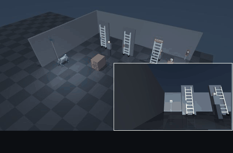
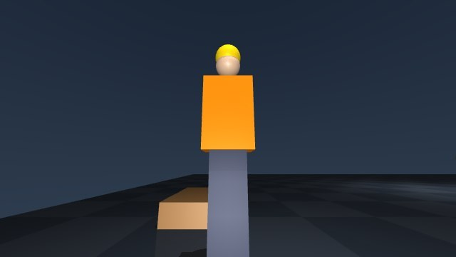
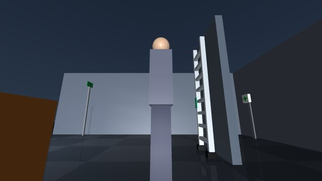

# Site safety sweep (fire / first aid / escape routes / PPE)

| PPE OK | PPE violation (flagged) |
|---|---|
|  |  |

Beyond the ladder protocol, patrol 0 can sweep nesseler-style site-safety
stations. Checklists are data: `src/ultron/assets/site_safety_v1/` mirrors
`inspection_v1` (rubric, strict response schema, system + section prompts) and
covers 9 criteria in 4 sections (`ext.*`, `firstaid.*`, `flucht.*`, `psa.*`),
derived from the BG BAU first-aid/fire-protection template and the
risk-assessment effectiveness check in the
[nesseler data](https://github.com/ctrl-rwth/ctrl-hackathon-2026/tree/main/site-safety-patrol/nesseler-data).

## Run

    PYTHONPATH=src MUJOCO_GL=egl python3 -m ultron demo --out runs/safety-demo --patrols 1 --safety

(Use `MUJOCO_GL=osmesa` where EGL is unavailable or wedged; see
`docs/DISPLAY_TROUBLESHOOTING.md`.)

The sweep emits events (`events.jsonl`) and writes `safety_sweep.json`:

| Event | Meaning |
|---|---|
| `SAFETY_TARGET` | grid-validated sweep goal chosen for a prop (`asset_kind`) |
| `SAFETY_ASSET_CONFIRMED` | segmentation oracle confirmed the prop (scene ground truth) |
| `SAFETY_EVIDENCE_CAPTURED` | keyframe saved for the VLM bundle |
| `SAFETY_VIOLATION` | `violation`: `PPE_HELMET_MISSING` / `PPE_VEST_MISSING`, with evidence frame |
| `SAFETY_CHECK_INCOMPLETE` | approach blocked or prop not visible — never silently OK |
| `SAFETY_SWEEP_SAVED` | `safety_sweep.json` manifest written |

## VLM assessment (offline builder, no API call)

    PYTHONPATH=src python3 -m ultron.assessment request runs/safety-demo/safety_sweep.json --model YOUR_MODEL --out /tmp/body.json

The manifest carries `"pack": "site_safety_v1"`; the builder produces a strict
9-criterion request. Images in one sweep bundle are different stations of the
same confirmed site visit. Clean proposals stay review-pending; there is no
automated pass, and `dashboard_payload` (ladder `Inspection` verdicts) rejects
this pack by design — site safety publishes events, not verdicts.

## Dashboard (note for Aravind)

No model change required today: `SAFETY_*` flow through the existing `Event`
contract (free-form `type` + `data`) and photos through the normal upload path
(`tests/test_site_safety_pack.py::DashboardEventCompatTests` pins this).
Optional follow-up owned by the dashboard: render `SAFETY_VIOLATION` events red
in the live feed and group `SAFETY_*` under a "Site safety" card. Any schema
change to `Event` is a contract update and needs both sides.

## Limits

Prop discovery and PPE flags are segmentation-oracle outputs from scene ground
truth, not learned perception. The VLM judges only captured frames; unseen
stations stay UNKNOWN/NOT_CHECKED. Nothing here certifies the site as safe.
The other three nesseler checklists (scaffold, low-dust, subcontractor
briefing) are future data-only pack additions.
