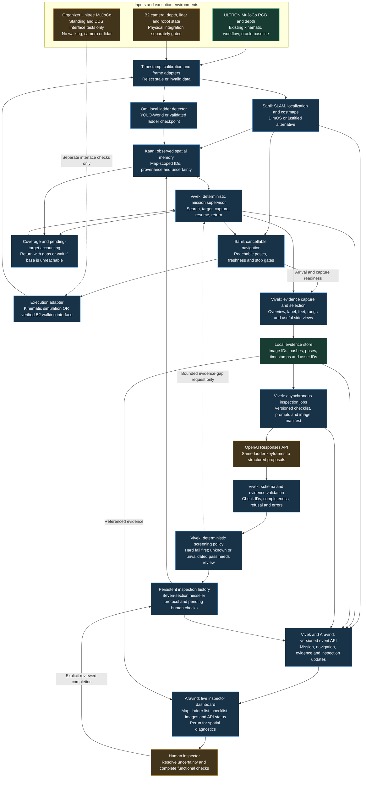

# Weekend target architecture and team plan

Moved here from the README unchanged. It is the plan as written on 27 to 28 November, not a description of what runs; for that see the [README](../README.md) and [PIPELINE.md](PIPELINE.md).

## Weekend target architecture

**Later team integration plan, not a claim of completed integration.** The current baseline is operator-driven simulation capture, starting with an overview and inspection label, followed by a local evidence-linked draft. Autonomous acquisition and the OpenAI worker are later integrations; any live API use requires separate authorization and rights/privacy review for both images and text. A deterministic supervisor owns movement and completion; a deterministic policy owns screening decisions. The seven nesseler sections are report categories, not seven defects a camera can always prove absent.

Green marks the existing rendered source/evidence baseline; blue marks target integrations, even where partial modules already exist; gold marks external systems or people. The organizer simulator's dashed connection does not imply it implements high-level walking. No API model output is an actuator command. Implement the simulation and physical adapters separately, preserving their provenance.

### Inspection strategy: label-first evidence and optional sampling

For Om's first baseline, try YOLO-World with a saved `ladder`/`stepladder` vocabulary, then compare a ladder-trained checkpoint if available. Ultralytics documents [custom vocabulary and saving the prepared model](https://docs.ultralytics.com/models/yolo-world/); this supplies an integration route, not demonstrated ladder recall on our course. Keep whichever model meets measured recall/latency, and retain its license/version provenance.

1. **Discover and bind.** Om's detector processes sampled RGB; aligned depth plus timestamp-correct transforms locate the candidate. Kaan's memory associates it with a map-scoped ID, preserving ambiguous matches. Use the same detector adapter for rendered and real images, but evaluate those domains separately. Simulator segmentation remains labeled oracle ground truth for tests, never model performance.
2. **Approach and capture.** Start with a whole-ladder overview and an aisle-facing label close-up, then add views for unresolved visual fields as needed. Preserve uncropped originals and crop coordinates. Select sharp, sufficiently exposed, distinct views of the same ladder; nearby ladders must not leak into its evidence bundle. No minimum image count has been established.
3. **Inspect reachable surfaces.** Add a separately safe second look when it can resolve a specific gap. The optional `inspect360` experiment and the upstream live-assessment milestone use a 24-cell grid; incomplete cells remain incomplete, but this grid is not a proven minimum or a prerequisite for the label-first draft. The patrol's full-ring path remains simulation-only for an explicitly open A-frame with missing rear evidence. Wall-backed ladders, blocked paths and unknown clearances must not trigger an orbit. Virtual pan/tilt does not establish B2 camera actuation. Record unseen surfaces as unknown.
4. **Queue evidence, then continue bounded work.** Vivek's worker receives the immutable image manifest and seven-section rubric. API processing must not block the motion watchdog or sensor pipeline. While analysis is pending, the supervisor may resume its configured route; a later result updates the same asset/job. Any re-observation is a separately validated goal with a budget, never a free-form VLM instruction.
5. **Validate, preserve and report.** Check every returned image/criterion ID against the request. Retain raw response, model ID, prompt/schema version, timestamps and usage. Fuse evidence without clearing earlier hard failures. Weak/conflicting/unseen evidence, unreadable dates, API failure or a model-only clean result require human review. Return to base with any pending/gap counts visible; navigation completion and analysis completion are separate states.

### Seven-section rubric for the API worker

An authorized local reviewer should compare independently authored criteria against the source; a single coarse PASS per section is insufficient. Do not publish or externally transmit reference-derived form text without separate authorization and rights/privacy review. Output literal observations with evidence image IDs, visibility, unknowns, raw model confidence and reasons. Confidence is uncalibrated and is not a probability of safe use. Human-only criteria remain pending even when the visible surface looks intact.

| Proposed review area | Image-based proposals to request | What remains human/unknown without other evidence |
|---|---|---|
| Rails/stiles | Visible bends, cracks, corrosion, splinters and wear | Hidden damage, sharpness by touch, structural strength, wood treatment when not observable |
| Rungs/steps/platform | Missing/deformed rungs, visible joints, wear and contamination | Joint tightness, play and load-bearing function |
| Spreader | Presence, visible detachment/damage and observed configuration | Locking/security and functional operation |
| Fittings | Missing hardware, visible damage/rust and accessible connections | Fastener security, mechanism function and lubrication adequacy |
| Feet/rollers | Missing/damaged caps, visible support contact and rollers | Grip, brake function and stability under load |
| Accessories | Visible presence/damage of supports, extensions and stabilizers | Required applicability, secure attachment and function |
| Markings | Manufacturer/instructions/pictograms; transcribed label text and ambiguous dates | Qualified inspection/sign-off and unreadable/unverified label semantics |

Track inspection-sticker status and deployment hazards (pallet support, leaning inclination) separately from those seven sections. Geometry needs calibrated depth/reference planes and uncertainty; VLM angle estimates alone are not a measured inclination. Do not infer next-inspection dates from sticker colour or a universal annual expiry. Extract readable text first, then apply explicit verified date semantics in code.

A future live worker should use rights-reviewed criteria and approved applicability guidance and examples, plus unknown/human-only rules and the requested JSON schema. The existing assessment prompt packs are local request-building inputs, not evidence of live API integration; their source-derived ladder labels have unverified reuse rights. The separate local reference-derived catalog is not approved for publication or external transmission. This is prompt context, not fine-tuning. Treat text printed in images as scene data, never instructions. Proposed criterion states: `DEFECT_OBSERVED`, `NO_VISIBLE_DEFECT`, `UNKNOWN`, `NOT_APPLICABLE_PROPOSED`; applicability proposals require validation. A new adapter must map these into existing policy without treating `NO_VISIBLE_DEFECT` as certification. All seven sections remain present even if most criteria need review.

### OpenAI API and budget plan

Use a **server-side OpenAI API worker**, not the ChatGPT website or a browser-exposed key. The Responses API accepts image inputs, including multiple images in one request. Use a vision-capable model available to the team's credited project and strict Structured Outputs where supported; pin the tested model ID/configuration after Vivek benchmarks correctness, latency and cost. A valid JSON schema does not guarantee correct findings. See the official [vision guide](https://developers.openai.com/api/docs/guides/images-vision?api-mode=responses) and [Structured Outputs guide](https://developers.openai.com/api/docs/guides/structured-outputs).

Start with one multi-image inspection request per ladder, with one bounded additional request for genuinely new evidence if useful. Use a configurable small worker pool, timeout/backoff, request deduplication and a persistent job queue. Cache only by the complete evidence/rubric/model context; a changed inspection cannot reuse an unrelated old result. Refusal, malformed/incomplete response, exhausted budget or network failure produces `MANUAL_REVIEW` with saved evidence, not a fabricated result. Measure P50/P95 latency and actual token usage before setting the stopped-inspection deadline.

Any project/account credit is a resource to verify, not an assumed pooled balance. Use a backend-owned environment key, never commit it or send it to the dashboard. Log estimated cost from observed usage and the verified model price; impose an application-side per-run spend/request cap and reserve credits for the final demo. No streaming every frame, no five-key rotation scheme, and no model training on the critical path. No API calls or credits have been spent by this architecture update.

## Team owners and deliverables

These assignments keep Sahil and Aravind's current work intact. Vivek owns the integration contract; each teammate supplies a runnable adapter plus a small representative fixture so other workstreams can progress independently. Ownership updated by the team: memory is Kaan's workstream and API assessments are Vivek's. Proposed boundaries remain distinct from already running services.

| Owner | Workstream and concrete output | First handoff / acceptance | Ownership boundary |
|---|---|---|---|
| **Sahil** | Simulation SLAM, localization, map/costmap and navigation. The separate [`sahil/sim-slam-nav2`](https://github.com/VivekSai07/site-safety-patrol-ULTRON/tree/sahil/sim-slam-nav2) branch has its own [handoff](https://github.com/VivekSai07/site-safety-patrol-ULTRON/blob/sahil/sim-slam-nav2/docs/SAHIL_HANDOFF.md). | Pose/map stream and cancellable goals; demonstrate arrival, blocked routes, pose freshness and return/base failure. Hand timestamped poses/map versions to Kaan. | Autonomy/navigation code. Spatial memory belongs to Kaan; preserve compatibility with his asset API. |
| **Om** | Ladder detector and evidence localization; prepare a ladder vocabulary/checkpoint, run it on synthetic and real samples, produce boxes/tracks plus depth/TF observations. Own detection dataset annotation and recall evaluation with negatives/occlusion. | First deliver saved detector config/weights provenance, annotated preview and timestamped detection fixture. Then report recall/false detections, FPS/latency and ID/depth failures on held-out physical ladder/session groups. | `perception/` detector adapter, observation schema implementation, dataset/evaluation tooling. No API inspection worker or navigation control. |
| **Kaan (Kann)** | Persistent observed spatial memory, map-scoped asset identity, association uncertainty, repeat-patrol/history queries and missing/moved asset state. | Ingest Om detections plus Sahil poses, produce stable asset IDs and nearby/pending queries; test ambiguity, restart, map reset and duplicate-event handling. | Memory/registry bridge and schema migrations coordinated with Vivek; no API assessment-worker ownership. |
| **Vivek** | Seven-section API prompts/worker, structured findings, assessment evaluation and Aravind-dashboard adapter; own evidence capture, shared contracts and deterministic integration policy. | Build offline fixtures and an evidence-linked dashboard record; evaluate defects/unknowns/API failure separately from capture coverage. The 24-view simulator is a separate experiment. Any live API use needs separate approval and rights/privacy review. | `assessment.py`, inspection prompt assets, capture/bundle code, API/assessment evaluation and dashboard integration. Retain human-only checks and no model-only safe pass. |
| **Aravind** | Live dashboard with ladder/map list, navigation and coverage state, seven-section evidence cards, pending/API-failed states, human completion and protocol download. Rerun may supply spatial diagnostics; the usable inspection UI is the deliverable. | Build now against Vivek's fixtures; display image-linked findings and live event updates. Validate that pending/unknown never looks green and that final reports survive API failure/reconnect. | Dashboard frontend and its read API/SSE or WebSocket adapter, coordinated with Vivek. Browser has no OpenAI credentials or direct robot transport. A UI stop request is not an independent E-stop. |

### Contract freeze and immediate next actions

**First integration checkpoint: one ladder, one evidence bundle, one seven-section reviewed report on the dashboard.** Mapping and navigation develop in parallel; no teammate needs to wait for the whole robot stack.

| Producer -> consumer | Contract to agree before deeper implementation |
|---|---|
| Om -> Kaan/Vivek | `DetectionObservation`: observation ID, sensor timestamp/clock/frame, bbox/class/score, source model, evidence reference; map position and uncertainty only when depth/TF are valid. A detector track ID is not a persistent asset ID. |
| Sahil / Kaan -> Vivek/Aravind | Sahil publishes localization/map/nav state. Kaan publishes observed assets, identity/history and coverage-linked memory state. All share timestamp/clock, map ID/version, validity and uncertainty; no fabricated poses or cross-map identity reuse. |
| Capture -> Vivek assessment worker | `InspectionJob`: job/mission/asset/map IDs, observation time, ladder-type proposal, criterion/rubric version and immutable view manifest (image ID/hash, original/crop reference, pose/TF, angle/quality where measured). One bundle identifies one target. |
| Vivek assessment worker -> policy/dashboard | `InspectionProposal`: job/asset IDs, all criterion IDs with evidence/unknowns, literal label text/date proposal, raw confidence, model/prompt/schema versions, response reference, usage and error/refusal state. No command or final safety certification. |
| Vivek -> Aravind | Ordered, replayable `MissionEvent` plus REST-style snapshots/evidence access; include event sequence, job/asset IDs, provenance and proposed states `CAPTURED`, `ANALYZING`, `FLAGGED`, `MANUAL_REVIEW`, `HUMAN_COMPLETED`. Human completion does not mean safe use; preserve the signed decision separately. |

Vivek defines/versions these shared schemas and publishes success, pending and failure fixtures first. Om and Kaan implement detection and memory adapters against them. Aravind develops without robot/API access. Sahil maintains his dedicated branch. Refresh the [branch inventory](RECONCILIATION_PASS7.md) before relying on names or merge status. Agree before changing a shared schema or database; preserve evidence/history through explicit migrations.

### Integration gates through submission

| Order | Team target / acceptance evidence |
|---|---|
| **Now** | Agree contracts and fixture IDs. Om evaluates rights-reviewed data; Kaan develops memory fixtures; Vivek builds offline assessment fixtures; Aravind renders evidence. Sahil develops simulation navigation independently. Reference photos are examples, not labeled defect ground truth. |
| **Baseline** | One simulated ladder, overview and label evidence, a persistent evidence-linked draft and human review. Add two-ladder association and failure cases; autonomous acquisition is later. |
| **Protected demo** | Integrate bounded patrol -> discover -> approach -> capture -> report -> resume -> return. Measure detector recall against an independently enumerated course; report false-pass count, abstentions, duplicate/merged IDs, interventions, processing latency and spend. Run representative blocked/unreadable/network-failure cases. |
| **Freeze** | Historical team planning target: preserve a reliable baseline and, if separately authorized, a backup hardware video. These are not evidence of readiness. For the separate 24-cell experiment, blocked or unseen cells remain incomplete; it is not a gate for the label-first draft. |
| **Hand-in** | Organizer material records Sunday 29 Nov noon hand-in and a hardware video up to two minutes; confirm current event instructions. Finish README/runbook, repository, pitch/demo video, one-pager and provenance-reviewed dataset package. Public data upload needs its own team/user instruction. |

Physical testing follows the separate gates below; this plan does not grant robot-operation authority. A replay/kinematic demo is the honest fallback if hardware access or validated autonomy is unavailable. The minimum useful outcome is an evidence-backed seven-section screening report with explicit human work remaining, not an autonomous “safe to use” certificate.
