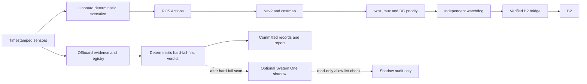

# Site Safety Patrol: Build Bible, Pass 7

**Working team reference.** Team baseline `0b97edb` and the Pass 6 material
remain historical comparison points. Team main at `79fb408` added a
dashboard and versioned assessment prompt packs; this reconciliation also
includes the label-first and detection-world work. Use `git rev-parse HEAD`
to identify the actual snapshot under review. This is not evidence of physical
deployment, approval, legal compliance or a completed inspection.

**Read first:** develop primarily in simulation; complete integrated hardware
deployment requires the full-system simulation gate **and** separate real-world
readiness. Isolated, authorized component hardware tests may occur earlier
without full-system simulation acceptance. The exact policy is in
[Simulation-first to hardware](../SIM_TO_HARDWARE.md). No robot connection or
hardware test is authorized by this document.

**Sources and comparisons:** [Pass 7 reconciliation](../RECONCILIATION_PASS7.md),
[team source review](../SOURCE_REVIEW.md), [design](../DESIGN.md),
[jury strategy](../JURY_STRATEGY.md), [event handoff](../EVENT_HANDOFF.md),
[pitch](../PITCH.md) and [historical validation](../VALIDATION.md). Om's Pass 6
Bible, eight research reports and 81-row integration ledger remain in the
personal workspace; they are not included in this team checkout. The organizer source PDFs are not included in this team checkout. The
Nesseller ladder checklist was checked in the local organizer source
checkout. The source-specific local catalog is excluded from distribution
pending rights review. The public synthetic example and
[baseline summary](../LABEL_FIRST_BASELINE.md) are not the official form or
evidence of complete form coverage; the PDF is not copied here. The DGUV
source edition still requires verification. Team comparison documents are
retained. For the next review, use the
[attachment list](BUILD_BIBLE_PASS7_ATTACHMENTS.md) and
[review prompt](BUILD_BIBLE_PASS7_REVIEW_PROMPT.md).

## Status legend

| Label | Meaning |
|---|---|
| **EXISTS: SIM** | Present in ULTRON's simulation, subject to the actual test environment. |
| **EXISTS: ADAPTER** | Code exists but the named external SDK, real model or hardware path is not verified end to end. |
| **PROPOSED** | Design, acceptance target or future task; not implemented or approved merely because it appears here. |
| **OPEN** | Team decision or evidence is still required. |
| **MUST TEST** | Explicit gate; no simulation-only result substitutes for its real-world check. |

Values in the simulation are configuration choices, not physical robot
limits. A plan with a numeric threshold is not a calibrated model, regulatory
claim, approved interface or measured result.

## 1. Mission and safety boundary

### 1.1 Objective and tiers

The desired product is an evidence-backed, bounded construction-site ladder
patrol. The robot discovers a ladder, associates a persistent identity,
approaches a validated observation pose, captures stationary evidence,
records a conservative screening outcome and resumes patrol. It retains
history, uncertainty and coverage gaps for a qualified human.

**Current priority correction (synthetic HTTP probe):** the baseline
is a simulation-only, operator-positioned, label-first ladder evidence
capture followed by an evidence-linked checklist draft for qualified human
completion. A minimal synthetic form example and the limits of the locally
retained source-specific map are described in
[LABEL_FIRST_BASELINE.md](../LABEL_FIRST_BASELINE.md). The existing
autonomous-style demo remains a separate simulation reference; autonomous
acquisition is later work. A rendered synthetic capture-to-draft probe used
HTTP inputs and manual fixture transcription; bounded browser controls and
focus were checked separately in specified simulation setups. Automatic label
reading remains untested. Neither this priority nor the form map claims a
completed inspection or physical operation. See
[validation](../VALIDATION.md).

| Tier | Scope | Admission and fallback |
|---|---|---|
| T1: protected baseline | Bounded localization/patrol, discovery, identity, overview/close-up, evidence, deterministic verdict, history and route resume. | Preserve a reproducible baseline; use review or a disclosed degraded mode when required data or safe motion is unavailable. Physical autonomy is not yet demonstrated. |
| T2: targeted improvement | One evidence-driven second look, optional verified posture, improved defect/label reader and interchange export. | Add selectively without destabilizing T1; an isolated component test may occur early under the hardware policy, but integrated T2 operation needs its baseline and deployment gates. |
| T3: isolated experiment | Offline viewpoint studies, anomaly models, advanced simulation and optional System One shadow audit. | Off by default where applicable; never a dependency of T1 or a source of motion authority. |

`AUTOMATED_PASS` means only that configured visual screening fields were
complete under the applicable validated policy. It never means a ladder is
safe to use. `safe_to_use=false`, tactile/functional checks and qualified
human sign-off remain explicit. A robot cannot establish bolt tightness, lock
function, load capacity or a legal release from a photo.

### 1.2 Verdict and coverage are separate

| Status | Meaning | Required action |
|---|---|---|
| `FLAGGED` | A qualifying hard-fail observation or overdue label. | Preserve evidence and reason; never erase the failure with a later pass. |
| `MANUAL_REVIEW` | Required evidence is missing, untrusted, conflicting or unavailable; scope is unknown. | Record the exact uncertainty and route to a qualified human. |
| `AUTOMATED_PASS` | Scoped checks are complete with no fail or abstention. | Show the limited scope and human/tactile footer; never certify safe use. |
| `MISSING_EXPECTED` | Asset state for a previously expected ladder not reconciled in the current mission. | Preserve its history and investigate; this does not prove physical removal. |
| `COVERAGE_INCOMPLETE` | Mission-level gap, such as an unscanned zone or missing expected asset. | Report the gap separately from a ladder's verdict. |

An unobserved part of an otherwise observed ladder is not a site-coverage
failure by itself. Conversely, completing waypoints does not prove every
area was visible or every ladder was detected.

### 1.3 Current reality

| Capability | Current state and limit |
|---|---|
| Patrol | **EXISTS: SIM.** A* on a bounded inflated 2-D grid drives a kinematically placed base, not a walking controller. |
| Images and depth | **EXISTS: SIM.** MuJoCo renders RGB, metric depth and segmentation. Camera placement is assumed; fixture/oracle labels are not real detections. |
| Discovery | **EXISTS: SIM.** Fixture-key observations and segmentation provide detections; three sightings are counted, but this is not a real consistency or recall test. |
| Inspection | **EXISTS: SIM.** Findings and label dates are scripted fixtures; one optional side recovery is scripted, not proof of component visibility. |
| History | **EXISTS: SIM.** SQLite stores map-scoped assets and ordered inspections; ambiguous neighbors are not silently merged. |
| Model adapters | **EXISTS: ADAPTER, limited smoke tests.** A local CPU YOLO-World ladder predictor was exercised on synthetic views and four real photos. The real sample is not independently annotated or held out; label accuracy and real-world performance remain unvalidated. See [evaluation](../DETECTION_EVALUATION.md). |
| Label-first capture/draft | **EXISTS: SIM, bounded probes.** Rendered 1280×720 synthetic capture, HTTP movement/STOP and a local source-specific manual-fixture draft were observed; browser controls and focus were checked separately. The public example is not an official form. Automatic label reading and real inspection remain unverified. See [validation](../VALIDATION.md). |
| Detection test hall | **EXISTS: SIM.** An independent example has a stationary B2, free virtual camera, synthetic labels and segmentation-derived visible ground truth. The previously tested Sahil hall requires an explicitly supplied local source pending rights review. Neither is a calibrated robot camera or real detection result. See [world usage](../DETECTION_WORLD_USAGE.md). |
| Organizer B2 DDS | **EXISTS: SIM, bounded probes.** Headless LowState and a separately wrapped isolated viewer/stand run with finite command/state samples were observed. Browser GUI/host access, walking and hardware remain untested. See [organizer B2 simulation](../ORGANIZER_B2_SIM.md). |
| Robot interface | **EXISTS: ADAPTER.** A B2 SDK hook exists but is not a hardware safety supervisor or proof of a functioning robot interface. The demo never connects to it. |
| Dashboard and assessment | **EXISTS: ADAPTER.** The dashboard and its per-ladder PDF path are separate from the legacy report. The assessment adapter constructs hash-bound request bodies and validates proposals without calling an API; the optional live adapter has a separate approval boundary. End-to-end robot/API integration remains unverified. See [dashboard](../DASHBOARD.md) and [API prompts](../API_PROMPTS.md). |
| ROS and Nav2 | **PARTIAL.** ROS replay is visualization only. A separate dashboard bridge can send Nav2 goals when goals are enabled; it does not prove simulation isolation. Real Nav2, real-bag ingestion and the proposed executive remain unverified. Rerun and DimOS runtimes remain unverified. |

Dashboard goals are off by default. Do not start the goal bridge where a real
action server could be reached: the bridge has no independent hardware or
network-isolation guard. A localhost URL, namespace or ROS domain alone is not
proof of isolation. No hardware connection is authorized here.

## 2. Deployment policy and acceptance

### 2.1 Validation stages

1. **Component and unit tests:** validate schema, deterministic policy,
   missing/conflicting data, errors, timeouts and boundary values.
2. **Simulation workflows:** run the selected full mission configuration in
   MuJoCo, including multiple patrols, blocked poses, missing expected assets,
   no-recovery and intervention/fault cases. Record oracles and stubs.
3. **Recorded-data replay, where applicable:** use authorized real captures
   with timestamps, calibration and source provenance. A missing replay path
   or missing required recording remains a gap, not an implied pass.
4. **Full-system simulation gate:** define the actual enabled configuration
   and expected outcomes before running; all required applicable cases must
   pass. Record revision, configuration, commands, results, artifacts, known
   approximations, owners and reviewer decision. A changed baseline requires
   the affected gates to be repeated.
5. **Real-world readiness:** independently verify actual B2 interface,
   localization, timing, sensors, communications, RC priority, independent
   watchdog/stop and physical E-stop; measure the controlled environment and
   supervise operation. Sim acceptance alone cannot establish these facts.

For complete integrated hardware deployment, steps 1–4 must be accepted
before step 5 and an explicit go/no-go. Do not substitute kinematic motion for
stability, stopping distance, foot slip, real-world depth, glare, OCR,
radio-loss or E-stop measurements.

### 2.2 Early component tests are an exception, not deployment

An authorized human may perform a bounded test of one isolated component
before the full-system simulation gate, after component-appropriate tests,
risks, interfaces, operator, environment, stop/recovery and abort criteria
are recorded. Read-only acquisition must remain non-actuating. Any motion,
however small, additionally requires verified RC priority, an independent
watchdog/stop, a functioning accessible E-stop and a responsible operator.
No exception authorizes the complete integrated solution or waives the
eventual full-system simulation and hardware gates.

## 3. Architecture and ownership

### 3.1 Proposed target; current implementation is smaller



The physical E-stop is independent of this software path. Diagram boxes
describe the **proposed** architecture, not current ROS nodes. The offboard
evidence pipeline may supply data to the deterministic executive through
validated contracts; it does not publish robot commands. The shadow lane
ends at audit and has no edge back to motion, the verdict or the safety veto.

### 3.2 Boundaries and future contracts

| Boundary | Proposed responsibility | Failure behavior |
|---|---|---|
| Onboard executive | Own mode transitions, preemption, validated goals, local recording and safety-state checks. | Stop/hold on loss of required safety signals; require guarded operator recovery. |
| Motion chain | Arbitrate RC before the tested watchdog and approved B2 control bridge. | Use zero command or verified `StopMove`; never assume a software endpoint replaces the physical E-stop. |
| Sensor adapter | Deliver synchronized RGB, registered depth, intrinsics, shutter-time TF and health. | Missing/stale/invalid inputs become unknown or hold; never substitute a current TF for an image-time transform. |
| Offboard evidence | Detect, pin, associate, assess and store evidence; no direct control authority. | Preserve original evidence; queue or degrade safely when the network or a model fails. |
| Registry/report | Append events, expose history and render committed records. | A display or export failure must not change a verdict or destroy source data. |
| Shadow experiment | Read a copy of already selected options after hard-fail scan, log an optional recommendation. | Timeout, invalid response or server loss → `NO_RECOMMENDATION`; no baseline effect. |

The proposed executive is `py_trees_ros` calling four action interfaces:
`FollowPatrol`, `ApproachPose`, `CaptureBurst` and `SetBodyPose`; a coordinator
would implement the servers rather than form a second executive (R-05,
R-56). These packages and the `DECISION_SHADOW_ENABLED` flag **do not yet
exist** in this repository. Do not add a competing controller merely to make
the diagram look complete.

### 3.3 Repository and interface discipline

The team repository is the implementation source. Keep Python 3.10 support
for ROS Humble; isolate optional model environments and check licenses for
both source code and weights. Add adapters around the existing simulation
rather than replacing it. The SQLite schema is already in use: schema changes
need an explicit migration or a separate database, a backup and backward
compatibility tests. Keep raw runs, secrets, private data and reference PDFs
out of Git.

The personal workspace is a separate repository that contains this team
repository as a submodule. Team contributions live on a reviewable branch;
publish the team commit before publishing a personal Git pointer to it.
Preserve the team `main` baseline and do not infer a remote push from a local
branch or merge.

## 4. Patrol, navigation and active viewpoints

### 4.1 Mission lifecycle

**Current simulation:** start a map-scoped patrol; travel over bounded grid
waypoints; collect stationary discovery bursts; confirm a fixture sighting;
associate an asset; plan approach poses; capture overview and close-up
frames; fuse scripted findings; optionally attempt one side recovery; append
the inspection; resume the route; account for expected assets and return to
base. Its map, fixture identities and evidence are synthetic. Injected
`DEGRADED_TELEOP_ASSISTED` is a scenario label, not a working real operator
override.

**Proposed real lifecycle:**

1. A human measures the safe area, robot footprint, keep-outs and route;
   verifies safety functions and approves the map and configuration.
2. In SLAM setup, map and save the bounded environment. For patrol, reload
   the approved map and establish localization before autonomous motion.
3. Navigate only inside the approved zone. Stop or skip unreachable goals
   according to policy; do not silently clear obstacles or leave the zone.
4. On repeated, consistent detection, pause the route, transform valid
   depth at the image timestamp, associate the observation with a known
   ladder or explicitly create/hold an ambiguous identity.
5. Validate an observation pose, move through the authorized motion chain,
   settle and capture evidence. Reassess known fails before considering
   completeness or another view.
6. If exactly one safe additional view can resolve a named gap, try it within
   the approved budget; otherwise keep the gap and escalate. Commit the
   record before resuming the next unvisited waypoint.
7. Reconcile expected assets and searched-area evidence separately, return
   or hold safely, and deliver an honest record of interventions, unvisited
   areas and uncertainties.

For localization faults or loss of required safety signals, the conservative
default is stop-and-hold; operator recovery and guarded resume are required.
The behavior for offboard Wi-Fi loss without a safety-signal failure is
**OPEN** (R-42): define it with local evidence retention and explicit tests,
not an assumption that all link losses are equivalent.

### 4.2 Pose generation and validation

The existing grid inflates obstacles by a simulation radius and rejects
blocked cells/paths. The `candidate_views` utility uses fixed map-axis
angles, not measured ladder orientation: its ordinary set has three
candidates. A full ring is produced only for an
`A_FRAME_STEPLADDER` when the caller explicitly sets all of
`full_orbit=True`, `open_space_confirmed=True` and
`rear_evidence_missing=True`. These are attestations, not measured
clearance. The normal demo does not call this utility for an orbit; it keeps
its overview/close-up and at most one scripted side recovery.

The **proposed** orientation-relative candidate set is Overview, CloseUp,
Side +50 degrees and Side -50 degrees. The 2.20 m overview and 0.90 m
close-up stand-offs in the research are unvalidated proposals; the current
demo uses different fixed coordinate offsets, 2.8 m and 1.6 m. The ±50
degrees proposal and the alternative 25–45 degrees remain unresolved
(R-15). Do not add a rear candidate to the default four-pose set or drive
behind a wall-leaning ladder. A separately guarded open-space A-frame
rear-view study is Tier 3 only.

Before any real pose is sent, the **proposed** six-gate funnel checks:

1. Inside the approved PatrolZone.
2. Outside keep-outs, with no target-cell clearing or reduced inflation.
3. Not behind a supporting wall or other inaccessible surface.
4. Full robot footprint against the unmodified, fresh costmap.
5. Measured local clearance and safe robot posture.
6. A valid path and bounded approach; fail closed if either is unknown.

The exact order and fallback are open (R-26); the close stand-off may
conflict with the padded footprint (R-25). Test candidate stand-offs on the
same unchanged map, log the rejected pose and reasons, and choose a separately
validated alternate or a safe hold/in-place capture. Never force acceptance.

For a selected second look, name the unresolved component or label first;
do not seek motion for its own sake. The current hackathon working default
is **one** additional reposition (R-44). The proposed ≤35 s reposition
budget and 45 s total per-ladder budget are distinct and require measurement.
Exposure adjustment is the first proposed response to glare; any approved
oblique shift must pass the same safety checks. If the gap remains, retain
the evidence and `MANUAL_REVIEW`.

### 4.3 Tilt and sensor timing

Tilt is **disabled for real use** until the actual B2 body-pose API, its
units/limits, neutral return, stability, link-loss behavior and transform
sign/order are independently verified (R-02, R-67). A proposed discrete tilt
uses stationary capture after a settle floor and an additional measured
motion/sharpness gate, never continuous sweeping while moving. The 0.8 s
floor is a starting hypothesis, not proof of settling. If tilt is unavailable
or fails, keep neutral views and report any missing evidence.

RGB, registered depth, intrinsics and transform must be timestamp-aligned.
Estimate a ladder position from valid depth on rails/visible surfaces, not
rung gaps; retain invalid-depth and covariance information. A stale
transform, unusable depth or uncertain association must abstain. These
sensor-time and orientation contracts are proposed; the simulator's
segmentation-backed projection is not a real calibration test.

## 5. Discovery, identity and persistence

### 5.1 Ladder type and visible scope

The current strings and templates below are kept for compatibility; they
are not a complete physical inspection standard. A separate label status is
also required for the current scoped verdict. Visual evidence and condition
must remain separate in the future schema: not visible is not a pass, and
`UNKNOWN_CONFLICT` preserves disagreement for review.

| Runtime type | Current required fields |
|---|---|
| `LEANING_SINGLE` | `stiles`, `rungs`, `bottom_feet` |
| `A_FRAME_STEPLADDER` | `stiles`, `rungs`, `front_feet`, `rear_feet`, `spreader`, `hinge_visual` |
| `EXTENSION_LADDER` | `stiles`, `rungs`, `bottom_feet`, `guide_brackets_visual` |
| `PLATFORM_PODEST` | `stiles`, `rungs`, `front_feet`, `rear_feet`, `platform_deck`, `wheel_brakes_visual` |
| `FOLDED_STORED` | `stiles`, `rungs`, `usage_state` |
| `UNKNOWN` | `stiles`, `rungs`, `feet`, `type_scope` |

`usage_state` and `type_scope` are placeholders requiring interpretation,
not proof that a visual check establishes applicability. A reviewed
type-alias mapping, complete UNKNOWN-type superset and explicit
not-applicable policy are future work (R-07, R-76). Empty or unrecognized
scope must not become an automatic pass. An optional non-template failure
still matters; an optional pass cannot fill a required field.

### 5.2 Discovery and association

The existing fixture benchmark counts at least three segmentation/oracle
sightings by fixture key and uses rendered depth to estimate a map
position. It does not validate multi-frame consistency, false-positive
rejection or real detector recall.

For a real sensor pipeline, the proposed gate is at least three consistent
observations with provenance, calibrated image-time transforms, depth
quality and map version. Consistency, localization tolerance and clustering
need measured definitions. Do not rely on a bare fixture key or infer stable
identity from color alone.

The current `Registry.associate` uses same-map, same-type, XY distance
within **0.65 m**. Exactly one candidate returns `REIDENTIFIED`; no candidate
creates `NEW`; multiple candidates create `REID_AMBIGUOUS`, without silently
merging. This is a prototype association radius, not a calibrated physical
distance. The research's separate 1.0 m proposal is not implemented.
Moved assets, type uncertainty, map changes and multiple nearby ladders
need explicit association and human-resolution tests; proximity alone is not
proof of identity.

Each mission has `PATROL-NN`, each asset `LAD-NNN`, and inspections have
their own database sequence. The current `MISSING_EXPECTED` routine marks
previous map assets not inspected in the mission; that is an investigation
signal, not proof the ladder was removed. It must remain distinct from a
mission's incomplete coverage and a seen ladder's missing component.

### 5.3 Existing storage and a safe extension

ULTRON's SQLite database currently has `missions`, `assets`,
`world_objects` and `inspections`; inspection details are JSON payloads.
An inspection is unique per mission/asset, and previous `FLAGGED` state is
carried forward pending a future human resolution flow. `world_objects`
are populated from simulation world truth, not a live semantic mapper.

The proposed normalized model separates `PatrolMission`, `LadderAsset`,
`InspectionEvent`, `CapturedView`, `ComponentCheck` and any shadow audit.
It should preserve event order, original crops, source and model versions,
image timestamps, map/calibration versions, rejection reasons, uncertainty,
operator intervention and qualified sign-off. Foreign keys, schema
versions, canonical IDs and append-only behavior are **design targets**,
not properties inferred from the current payload layout.

Before adopting it, design a versioned migration with a snapshot/backup,
foreign-key checks, transactional failure recovery, test fixtures for
existing databases and no loss of prior flags. Alternatively use a clearly
separate database until the team approves a migration. No silent schema
replacement or identity remapping.

## 6. Perception, evidence and deterministic verdict

### 6.1 What exists and what is missing

The demo's label dates and component readings are scripted fixture data.
`validate_findings()` separately validates model-proposed components,
visibility, reason and confidence. Its existing **0.85** threshold is an
uncalibrated prototype choice; a visible threshold-meeting `FAIL` on a
recognized component is retained even outside the required type template.
Unknown names, duplicates and invalid responses are rejected; a non-template
`PASS` does not complete required evidence. Invalid responses must surface
as an error or review, never a pass.

`evidence_gate()` fuses supplied check dictionaries, then applies the
deterministic verdict. Even complete model-derived passes are downgraded to
`MANUAL_REVIEW` pending calibration and human confirmation. The present
code does **not** scan every raw crop or derive all geometric hard failures;
it does not infer a conflict automatically from arbitrary competing
observations. Its fusion retains an explicitly supplied
`UNKNOWN_CONFLICT`, and a supplied `FAIL` dominates.

### 6.2 Required future evidence policy

1. Validate source identity, timestamp, crop/view linkage, ladder type and
   model/schema versions. Never combine observations from different
   ladders without a justified association.
2. Scan **all validated evidence for qualifying hard fails first**, including
   components outside a required template. Preserve each fail and source
   view; a later pass cannot erase it.
3. Resolve evidence only against an approved applicability template.
   Occlusion, low confidence, invalid depth, unreadable labels, unsupported
   type or disagreement remain unknown/review; empty scope cannot pass.
4. For the proposed real pass policy, require genuinely independent views
   and image quality checks. A research starting proposal is a ≥25-degree
   view separation; define orientation, visibility and thresholds with
   held-out data before adoption. Repeated correlated frames do not create
   independent certainty.
5. If an unresolved gap is eligible, perform at most one separately safe
   recovery. Re-run the hard-fail scan on the combined evidence; otherwise
   preserve uncertainty and escalate to a human.

The current `verdict()` itself scans supplied `FAIL` states before
completeness and treats an overdue label as `FLAGGED`; otherwise it checks
required fields and valid label status. A direct simulation-only call can
produce a scoped `AUTOMATED_PASS`; it is not the same as an approved
real-image inspection. The model path is more conservative and requires
human confirmation even when all model proposals pass.

### 6.3 Label, geometry and calibration

Future label handling should capture a readable image, extract literal
text/QR fields, retain the crop and reader output, and validate the date
format, reference clock, label semantics and applicable inspection policy.
An unreadable, inconsistent, future/expired or unrecognized format must be
handled under an explicit reviewed policy; do not infer a legally valid
inspection from a model's label classification. The current fixture compares
synthetic dates to a fixed `2026-11-27` simulation date.

Geometry checks can help locate rails, feet or unusual shapes, but project
guard bands are engineering proposals, not DGUV regulations or a substitute
for tactile assessment. Use held-out physical ladders and sessions to
calibrate detectors/readers, report false negatives and abstentions, and
separately validate any conformal or anomaly model. Do not share calibration
sets or claim coverage without recorded provenance (R-81). Dual-reader
thresholds, single-reader thresholds and parent-box confidence remain
unapproved (R-52, R-79).

## 7. System One, records and presentation

### 7.1 Optional shadow experiment only

System One and `DECISION_SHADOW_ENABLED` are **not implemented**. If the
team later introduces them, the flag defaults false and the service runs
offboard, asynchronously and read-only **after** deterministic hard-fail
scanning. Its narrow proposed scope is observation quality or multi-view
sufficiency, using a read-only copy of already allowed actions. Validate
the typed response and `action_ref`; append a shadow audit or
`NO_RECOMMENDATION` for timeout, invalid data or service loss.

No shadow output may feed the live executive, pose selection, recovery,
verdict, veto, command mux or hardware. Disabling or deleting the shadow
lane must leave baseline behavior identical. No live promotion is authorized
by the shadow gates. The experiment is optional, uses spare compute and is
the first feature cut if it threatens T1.

### 7.2 Existing and proposed reports

The existing end-of-run HTML/JSON report provides simulated events, frames,
assets, reasons and history; the per-file SHA-256 map supports integrity
checks of exported files. Portable replay and optional visualization are
separate from inspection authority. It is not a signed report, a canonical
manifest hash or a formal inspection certificate. A separate dashboard and
PDF export path now exist; their presence does not establish an integrated
live robot feed, verified official-form rights or a completed inspection.

A dashboard should display the map and coverage state, asset/history
list, latest record, evidence crops, reasons, uncertainty, source and
operator interventions. Show the difference between stale data, an
unreadable label, a physical failure and a missing expected asset. Exports
may include an unsigned prescreening PDF; the separate n.core-oriented
interchange mapping remains a proposal. Confirm form rights, partner fields
and interface provenance first. Do not invent an n.core endpoint, signature
or legal compliance claim.

A future canonical manifest needs a versioned definition of ordering,
serialization, included files, exclusions and verification; the existing
per-file hashes must not be relabeled as that manifest. Commit data before
publishing any event, preserve original evidence and record any human
resolution as a new authorized event rather than rewriting the old history.

## 8. Work plan, checkpoints and ownership

### 8.1 Team roles

The [team handoff](../../README.md#team-owners-and-deliverables) describes
Sahil's autonomy, Om's detection/evaluation, Kaan's assessment, Vivek's
integration and Aravind's dashboard workstreams. Confirm current ownership
with the team; these descriptions are not verified GitHub issue assignments.
The following role mapping remains a planning aid.

| Role | Primary responsibilities | Review boundary |
|---|---|---|
| Safety/executive | Robot bring-up, operator controls, watchdog, safety cases and executive. | Independent review of motion and hardware gates. |
| Navigation/motion | Map, localization, bounded patrol, footprint/pose validation and optional tilt. | Safety lead reviews motion-affecting changes. |
| Perception | Detection, image-time pinning, ladder scope, labels, defects and calibration. | Review model and data limitations with integration lead. |
| Integration/data | Registry, contracts, reporting, evaluation artifacts, video and delivery. | Coordinate sign-off and protect source/data provenance. |

### 8.2 Work breakdown

| WBS | Objective and dependency | Exit evidence |
|---|---|---|
| 01 Contracts | Freeze mission, evidence and persistence interfaces before dependent work. | Two-patrol fixture; checked schema/version and failure cases. |
| 02 Safety | Establish authorized component-test plan, RC, independent watchdog/E-stop and recording. | Bench results plus separate actual-equipment verification before motion. |
| 03 Navigation | Map, localize, enforce zone/keep-outs, patrol, approach and resume. | Selected simulation gate first; real localization/stop checks later. |
| 04 Discovery/identity | Detect, pin and associate without duplicate or unsafe merges. | Replay fixtures and measured real-data accuracy with ambiguity. |
| 05 Evidence/report | Capture, hard-fail-first verdict, history and understandable record. | Reasoned sample with image provenance, uncertainty and human footer. |
| 06 T1 integration | Reproducible complete software baseline and gated deployment. | Documented system-simulation acceptance and, separately, hardware readiness. |
| 07 Defect/geometry | Evaluate only selected detectors and visible checks. | Held-out results; no reduction of baseline safety or traceability. |
| 08 Label/export | Literal label extraction, optional independent reader, partner field mapping. | Disagreement → review; export semantics checked with partner. |
| 09 View recovery | Validated pose candidates and one second look; tilt remains independently gated. | Costmap replay, bounded recovery and unchanged T1 fallback. |
| 10 T3 experiments | Offline NBV, anomaly, advanced simulation or System One shadow. | Isolated result; no path to baseline motion/verdict and no T1 dependency. |
| 11 Evaluation/video | Seeded cases, sample sizes, honest failure records and backup demonstration. | Reproducible scorecard, artifacts and a truthful mode label. |
| 12 Delivery | Source package, approved data/rights, documentation and pitch. | Clean reproduction instructions, reviewer sign-off and confirmed hand-in list. |

The original schedule targets a Friday contract/safety/map start, Saturday
Tier 1 integration and baseline lock around 13:30, selected improvements and
backup video by 22:00, then Sunday packaging before noon. These are
**historical planning targets**, not evidence that deadlines or organizer
requirements were met. Reconfirm current dates, hand-in rules and ownership
against the actual event material.

Protect the integrated T1 baseline before enabling integrated T2 features.
The earlier blanket "no Tier 2 physical work before the baseline tag" is
refined by the user's newer instruction: an isolated, component-specific
hardware experiment can precede full-system simulation or the baseline
tag **only** under the separate early-test policy. It is not integrated
T2 deployment and must not weaken the final gates.

### 8.3 Go/no-go sequence

| Checkpoint | Evidence needed | No-go/default |
|---|---|---|
| Contracts | Versioned schemas, two-patrol data example, documented assumptions. | Keep packages isolated until the contract is reviewed. |
| Simulation safety/failures | Unit + rendered mission cases and failure-injection results, scoped to the enabled baseline. | Fix or disable the affected feature; do not claim readiness. |
| Full simulation | All selected system acceptance cases, evidence and reviewer disposition for the exact revision. | Complete integrated hardware deployment is blocked. |
| Real readiness | Actual interfaces, calibrated sensors, localization, controlled route, RC, independent watchdog, E-stop and named operator. | No motion when a prerequisite is missing or fails. |
| T1 baseline | End-to-end evidence, accurate autonomy mode, repeatability and recorded owner approval. | Use an honestly disclosed simulation or assisted fallback. |
| Optional improvement | Its own tests and a clear rollback, with baseline preserved. | Disable tilt, extra view, model or export independently. |
| Delivery | Verified artifacts, rights/privacy and organizer hand-in requirements. | Disclose missing artifacts; never replace real evidence with simulation. |

## 9. Acceptance catalog and evaluation

The original Pass 6 tests are **AT-01–AT-27**; **AT-28–AT-42** are
research-derived proposals. The following entries are summaries, not evidence
that any test has passed. Their full definitions and original provenance are
in Om's integrated reference, chapter 9. Some existing unit/rendered tests
exercise related simulated behaviors, but none by itself establishes
physical acceptance. For each applicable AT, choose a layer (unit/fixture,
simulation, recorded replay, bench or hardware), record revision, input,
expected and actual result, artifacts and reviewer. A non-applicable test
needs an explicit rationale; an unrun required test remains open.

### 9.1 Inherited tests: AT-01–AT-27

| ID | Acceptance objective |
|---|---|
| AT-01 | Neutral burst: assess frame sharpness and produce a valid rail-depth map pin. |
| AT-02 | In a measured clear area, demonstrate approved discrete tilt and return to neutral repeatedly. |
| AT-03 | After tilt, confirm camera/map transform returns within an independently measured tolerance. |
| AT-04 | Abort a command and measure the independent watchdog/E-stop stopping behavior; ≤500 ms is a candidate target, **MUST TEST**. |
| AT-05 | Demonstrate a sharp post-tilt image after the proposed settle floor plus a measured stability gate. |
| AT-06 | Measure whether approved tilt adds the intended upper-component visibility. |
| AT-07 | An A-frame rear-foot/spreader gap is resolved by a safe side view or remains unknown. |
| AT-08 | Recover a glare-obscured label safely or retain `UNREADABLE`. |
| AT-09 | Reject a blocked observation pose and select a validated alternative or abstain. |
| AT-10 | Associate front, tilt and side observations of one ladder with one identity. |
| AT-11 | A qualifying hard fail in any view flags the record and stops further unnecessary translation. |
| AT-12 | Preserve conflicting sub-threshold evidence and escalate `UNKNOWN_CONFLICT`. |
| AT-13 | Exhaust the approved per-ladder time budget and retain unresolved items for review. |
| AT-14 | Inject relevant network/safety-signal loss during reposition; verify the selected safe response and local evidence retention. |
| AT-15 | Disable dynamic viewpoints and verify the disclosed fixed-pose/assisted fallback. |
| AT-16 | Create and save a bounded map, PatrolZone, keep-outs and route. |
| AT-17 | Reload the map after a cold start and establish localization within an approved tolerance. |
| AT-18 | Complete the chosen waypoint route and reject goals outside the zone or inside a keep-out. |
| AT-19 | Handle a blocked waypoint/dynamic obstacle by safe replanning or documented skip. |
| AT-20 | Discover, pin, validate an approach and capture the intended inspection poses. |
| AT-21 | After committing an event, resume the next unvisited waypoint. |
| AT-22 | Re-identify a ladder across two patrols, append history and show a changed verdict. |
| AT-23 | Mark an absent expected asset `MISSING_EXPECTED` and its mission `COVERAGE_INCOMPLETE`. |
| AT-24 | Verify RC takeover, log the intervention and require guarded resume. |
| AT-25 | Handle an unreachable approach with an approved alternate, safe capture or hold. |
| AT-26 | Inject localization loss/jump and halt or enter authorized recovery without uncontrolled continuation. |
| AT-27 | Measure the scoped one/two-ladder mission with zero manual driving; the proposed three-minute target and course remain to verify. |

AT-07's physical success requires real visibility evidence; the current
scripted simulator recovery is only an analogue. AT-14 and AT-36 must follow
the ultimately selected network-loss policy, while safety-signal loss
remains stop-and-hold.

### 9.2 Proposed additions: AT-28–AT-42

| ID | Acceptance objective |
|---|---|
| AT-28 | Reject free-form or unauthorized pose requests; a shadow service cannot request motion. |
| AT-29 | Correct the research recovery fixture: exactly the intended gap remains; after one retry no second move is requested (R-17). |
| AT-30 | Use an explicit current clock for label-date logic; invalid/unreadable labels never pass. |
| AT-31 | Exercise the chosen hard-fail confidence boundary just below and at the threshold; 0.85 remains unapproved. |
| AT-32 | Permuting equivalent evidence must preserve verdict and canonical audit hash; empty/unsupported applicability must not produce an automatic pass. |
| AT-33 | Round-trip the versioned record and replay the same authorized recording twice against a golden result; reject incompatible contracts. |
| AT-34 | Test depth projection, nearby assets, tags, moved/missing assets, transform changes and no-pin behavior. |
| AT-35 | For a future normalized schema, enforce foreign keys and append-only event rows and reject invalid IDs. |
| AT-36 | Inject offboard loss and safety-signal loss separately; follow the selected policy, retain local recordings and count only actual interventions. |
| AT-37 | Compare nominal and alternative stand-offs against the same unmodified costmap and full footprint; retain every rejected or unknown result. |
| AT-38 | Repeated near-identical frames do not count as independent views; validate the proposed angular rule separately. |
| AT-39 | A required component without reliable evidence stays unknown; a coverage percentage alone cannot turn it into a pass. |
| AT-40 | Shadow timeout, invalid data, permutation or server loss leaves baseline behavior unchanged and produces an appropriate audit/fallback. |
| AT-41 | Once implemented, the same versioned canonical manifest hash verifies across record, audit and selected exports. |
| AT-42 | If a software stop is later provided, verify it routes through the approved onboard stop chain; it does not replace the physical E-stop. |

The proposed all-not-applicable case in AT-32 needs a reviewed applicability
policy: this reconciliation chooses the conservative default that an empty
or unsupported required scope must not pass. AT-35, AT-41 and AT-42 test
future capabilities, not the current database, hash map or a nonexistent
dashboard stop endpoint.

### 9.3 System One shadow-only gates

The following are proposed experiment criteria; they authorize **no live
recommendation or robot action**, even if all pass.

| ID | Shadow evaluation |
|---|---|
| S1-GATE-01 | Strictly validate every replayed response; invalid output abstains. |
| S1-GATE-02 | Service loss leaves baseline outputs unchanged. |
| S1-GATE-03 | Every call has an auditable request, model/version, outcome and error/timeout record. |
| S1-GATE-04 | No motion/control interface or write access; pin model revision and dependencies. |
| S1-GATE-05 | Returned option is in the read-only allow-list under option permutations. |
| S1-GATE-06 | No hard-fail misses in the predefined challenge set; report sample size and uncertainty without claiming certification. |
| S1-GATE-07 | Improve over fixed baselines on untouched, ladder/session-grouped data, including selective risk at matched coverage. |
| S1-GATE-08 | Pre-register and measure the option-order sensitivity limit; currently **OPEN**. |
| S1-GATE-09 | Pre-register a stopped-inspection deadline and measure cold/warm latency, timeouts and memory; currently **OPEN** and unrelated to the watchdog threshold. |
| S1-GATE-10 | Any authorized shadow rehearsal has independent safety review and still no execution path. |
| S1-GATE-11 | Disable the service on a boundary breach, stale output, silent fallback, missing audit, unresolved license or lack of demonstrated value. |

## 10. Metrics and risk register

### 10.1 Reportable measures

| Measure | Denominator and caveat |
|---|---|
| False scoped passes | Confirmed seeded hard-fail cases reported as pass / all confirmed seeded hard-fail cases; give count and sample size. A target of zero is not proof of zero risk. |
| Ladder recall | Unique real ladders observed / independently enumerated real ladders; report simulation separately. |
| Identity accuracy | Incorrect merges and duplicate IDs over repeated patrols, including moved and nearby ladders. |
| Coverage | Measured observable area and excluded/unscanned zones, not waypoint completion. |
| Evidence completion | Applicable required components with acceptable evidence / all applicable required components; list every missing item. The research's ≥90% is a proposed scorecard target, not a pass rule. |
| Recovery effectiveness | Resolved gaps / attempted second looks, plus blocked attempts and time distribution. |
| Autonomy | Operator interventions, confirmations, blocked goals and elapsed time, labeled by actual autonomy mode. |
| Label performance | Literal correct readings, unreadable/abstained cases and error counts on independent data. |

Also retain the dataset split, site/ladder diversity, lighting, failure cases,
baseline version and number of trials. Synthetic ground-truth recall or a
small 0/N result cannot establish real-world reliability.

### 10.2 Risks and defaults

| Risk | Default / mitigation |
|---|---|
| Kinematic simulator mistaken for walking or real SDK validation | Label artifacts synthetic; independently test the real motion chain. |
| Physical collision or lost control | No motion without measured route, RC priority, independent stop/watchdog, E-stop and authorized operator. |
| Unknown camera/TF or stale localization | Reject the observation/pose and stop or review, rather than invent coordinates. |
| Overconfident model, wrong type or hidden defect | Hard-fail-first over validated evidence; unknown/conflict → review; human tactile checks remain required. |
| Infeasible close-up due to inflation | Do not clear the target/costmap; compare alternatives, reject/hold and retain evidence. |
| Duplicate or merged ladder history | Map/type-aware association, explicit ambiguity and reviewed migration; preserve source events. |
| Unreadable/ambiguous inspection sticker | Retain crop and literal text; do not infer valid date or legal sign-off. |
| Loss of offboard service or GPU | Baseline and local evidence remain independent; disable optional services first. |
| Unsafe shadow feedback | Read-only audit sink, default-off flag, no motion/verdict/veto path; disable on any violation. |
| Private data or unverified rights in outputs | Obtain permission, redact, document licenses and review before any publication. |
| Requirement or standards mismatch | Preserve team comparison documents and obtain the actual organizer/DGUV sources before making a claim. |

## Appendix A. Simulation runbook and current evidence

From the team repository root, create a Python 3.10+ environment and install
the simulation extra as described in the [README](../../README.md#run-the-simulation).
The following writes a **new** output directory and does not connect to a
robot:

```bash
PYTHONPATH=src MUJOCO_GL=egl python -m ultron demo --out runs/pass7-demo
PYTHONPATH=src python -m ultron query runs/pass7-demo/memory.sqlite --text FLAGGED
```

Representative existing scenarios also include `--variant missing`,
`--variant blocked`, `--variant intervention` and `--no-recovery`. Use a
distinct output directory for each run. See the README for exact commands,
report/viewer options and dependency limits.

```bash
PYTHONPATH=src python -m unittest discover -s tests -v
PYTHONPATH=src MUJOCO_GL=egl ULTRON_RENDER_TESTS=1 python -m unittest discover -s tests -v
```

An earlier reconciliation ran 42 rendered tests in an isolated Python 3.10.12
environment with MuJoCo 3.17.0, NumPy 2.2.6, Pillow 12.3.0 and EGL. That is
historical evidence for its then-current checkout, not a result for a later
merge. See [validation](../VALIDATION.md) for subsequent checks; rerun the
actual baseline and retain its output with the gate record. None of these
checks is the formal full-system gate or hardware acceptance.

## Appendix B. Tool and dependency boundaries

| Component | Role and limit |
|---|---|
| Python 3.10+ | Repository minimum. Keep onboard contracts compatible with Humble/Python 3.10; a research `StrEnum` example needs a compatibility shim on 3.10. |
| MuJoCo, NumPy, Pillow | Optional `sim` extra. ULTRON's application renders sensor views but drives the base kinematically. |
| `unitree_mujoco` | Upstream low-level simulator can support separately scoped DDS/sensor experiments; it is not the high-level B2 sport-service implementation and is not what the current demo validates. |
| ROS 2 Humble, Nav2, TF2, MCAP | Proposed real integration/replay stack. Exact packages, topic names, QoS and hardware image remain to verify; no live navigation stack is provided by this repo. |
| Rerun 0.32.0 | Optional viewer dependency pinned by the repository. SDK/viewer operation must be verified in the target environment. |
| DimOS | Optional adapter based on inspected APIs; runtime and B2 compatibility are not validated end to end. |
| YOLOE/YOLO-World, Qwen3-VL | Optional model experiments, installed separately from the simulator. A limited local YOLO-World smoke run is documented; licenses, calibration, hardware fit and real generalization require further verification. |
| Isaac Sim, PatchCore, System One | Optional research directions; no implementation or claimed validated version is required for the baseline. |

Keep a reproducible dependency/model manifest for any chosen build. Review
each package **and** checkpoint/dataset license and permissions before
distribution. Do not fetch models, use a cloud reader or publish recordings
without an approved data/rights decision.

## Appendix C. Evidence and event contract checklist

This is a **proposed** contract checklist; the existing simulation payload
contains only a subset.

| Field group | Minimum design intent |
|---|---|
| Identity | Mission ID, asset ID, map version, event/view IDs, association outcome and ambiguity. |
| Capture | Original image/depth URI or local reference, capture timestamp and clock domain, sensor/calibration/TF version, robot/camera pose, quality and view name. |
| Observation | Component or label, visible/occluded/unknown, observed condition, source crop, model/version and confidence with calibration provenance. |
| Policy | Required applicability, hard-fail reasons, missing/conflicting items, proposed/accepted view decisions, retry and stop reason. |
| Safety/operations | Autonomy mode, actual operator interventions, pose rejection, route/coverage gaps and relevant safety events. |
| Outcome | Scoped verdict, reason, `safe_to_use=false`, tactile/functional checks pending and required human sign-off. |
| Integrity | Versioned schema, referenced file hashes, future canonical manifest definition and immutable original evidence. |
| Human resolution | Authorized reviewer, time, decision, rationale and links to previous events, appended rather than silently overwritten. |

Persist raw evidence and decisions before publishing; do not make a UI
render, a model response or an export the authoritative source of a
physical safety judgment. Real storage retention and access controls need a
team decision.

## Appendix D. Threshold register

All values below are **simulation settings or proposals**, not regulations
or verified B2 specifications. Keep units, reference frames and evaluation
data with every approved threshold.

| Quantity | Current / proposed value | Status and needed evidence |
|---|---|---|
| Sim speed/acceleration | 0.5 m/s, 0.8 rad/s; 0.6 m/s², 1.4 rad/s² | Current kinematic profile; not physical limits. |
| Sim command step | Default 0.1 s, maximum 0.2 s | Prototype command validation only; not a watchdog. |
| Sim obstacle radius | 0.65 m | Current grid inflation; not an actual robot footprint validation. |
| Current re-ID radius | 0.65 m same-map/type in XY | Prototype gate; 1.0 m research alternative is separate and uncalibrated. |
| Proposed pose stand-offs | Overview 2.20 m; close/side 0.90 m | **TO VERIFY**; the current simulation uses different offsets. Close poses may be rejected by the full footprint. |
| Proposed side angle | ±50 degrees; alternative 25–45 degrees | **OPEN**, R-15; do not assume the alternative's reference axis. |
| Proposed keep-out / clearance | 0.75 m / 0.65 m | Starting values only; apply unchanged within a chosen replay comparison and measure actual conditions. |
| Proposed additional views | One reposition; a later second is under discussion | Working default only, R-44; reject if safety or evidence requirements fail. |
| Proposed time budgets | ≤35 s for reposition; 45 s per ladder | Different quantities; **TO VERIFY**, R-15. |
| Settle floor | 0.8 s used by simulation; research proposes a floor plus a motion/quality gate | Not proof of a stationary real sensor; measure separately. |
| Independent-view separation | ≥25 degrees | Proposed evidence rule; no such check exists in current fusion. |
| Model component threshold | 0.85 | Existing uncalibrated code parameter; research thresholds are **OPEN**, R-52/R-79. |
| Watchdog stop | ≤500 ms candidate | **MUST TEST** independently on actual equipment; not the same as a Nav2 timeout setting. |
| Evaluation coverage | ≥90% applicable-component observation | Proposed scorecard target, not a verdict rule; every remaining gap must be reported. |
| Sim label clock | Fixed date 2026-11-27 | Fixture-only; real date/clock/label semantics are unverified. |

No quoted project-policy number becomes regulatory merely by appearing in
a figure, report or contract. Resolve approval and validation with the
responsible team and qualified domain reviewers.

## Appendix E. Open decisions and inherited kickoff questions

The integration ledger has 81 numbered entries; the following **11 R-items
remain open**. Owners and evidence are proposed; no one is assigned merely
by this table.

| ID | Decision and conservative default | Suggested owner/evidence |
|---|---|---|
| R-02 | B2 tilt interface, limits and failure response: disabled until verified. | Safety + motion; approved API, neutral return, measured tests. |
| R-15 | Side-angle alternatives and separate budgets: proposed ±50 degrees, not yet calibrated. | Motion; measured poses and timings. |
| R-17 | Original C5 recovery fixture versus engine behavior: retain unknowns and repair/review the fixture. | Perception; AT-29 with complete comparison evidence. |
| R-25 | Close poses versus padded footprint: no target-cell clearing; reject/hold and compare alternatives. | Motion + safety; AT-37 costmap replay. |
| R-26 | Six-gate order and fallback: merged order is a proposal only. | Motion + safety; gate contract and rejection tests. |
| R-42 | Wi-Fi loss versus loss of safety signals: stop/hold on safety-signal loss; team decides offboard-link behavior. | Safety + integration; fault-injection and local-recording evidence. |
| R-44 | One versus two extra repositions: one for the protected baseline. | Motion; review gain, time and safety data. |
| R-52 | Reader and parent-box thresholds: current 0.85 is not calibration. | Perception; held-out accuracy and explicit threshold selection. |
| R-79 | Approval of project-policy values: proposed until recorded and validated. | Safety + team; threshold register and decisions. |
| R-80 | Conflicting DGUV edition references: verify the actual document, do not choose from memory. | Domain reviewer; original publication and applicability. |
| R-81 | Conformal versus anomaly calibration provenance: keep datasets and claims separate. | Perception; independent sets and evaluation record. |

Additional chapter-local questions in the integrated handoff are not all
subsumed by the 11 R-items. In particular, assign the four team roles,
resolve exact applicability/UNKNOWN behavior, select recording and
dashboard contracts, decide whether System One is worthwhile, and
pre-register any shadow deadline and option-order criterion. Conflicts over
platform applicability remain open; do not silently make `platform_deck`
mandatory for every A-frame.

The Pass 6 kickoff decisions remain a useful checklist: **D1** verify sensors,
interfaces and network; **D2** choose the route/control baseline; **D3**
choose detection placement; **D4** decide network and loss behavior; **D5**
confirm label and required fields; **D6** select export versus any verified
partner API; **D7** set extension cutoffs and demo cases; **D8** decide
local/cloud data policy; **D9** budget isolated T3 work; **D10** approve
dataset rights and privacy; **D11** approve capture and staged test
equipment; **D12** freeze measured thresholds only after real evidence.
These are questions, not completed decisions.

## Appendix F. Data, source and standards provenance

- The team repository retains its
  [jury strategy](../JURY_STRATEGY.md), [source review](../SOURCE_REVIEW.md),
  [handoff](../EVENT_HANDOFF.md), [pitch](../PITCH.md) and
  [previous validation](../VALIDATION.md) for comparison. Their historical
  dates and host-specific statements are not present-day proof.
- Om's personal workspace retains the unmodified Pass 6 Bible, source
  reports C1–C6, EXTRA and C8, their stripped text and extracted figures,
  the integrated reference, figure specifications and reconciliation
  ledger. There is no C7 report in that source set. These materials are not
  bundled into the team repository.
- The source summaries disagree about the edition of DGUV Information
  208-016. The source PDFs are absent from this checkout; verify the
  [official publication](https://publikationen.dguv.de/widgets/pdf/download/article/450)
  and obtain qualified interpretation. Do not present a project threshold
  or prescreening report as a legal or regulatory certification.
- Dataset captures require permission, privacy review, calibrated metadata
  and physical-ladder/session-separated splits. A synthetic scenario's
  defect metadata is **not** a visible defect annotation. Do not damage
  working equipment for data and do not publish or select a license without
  explicit approval. See [data collection](../DATA_COLLECTION.md).

## Appendix G. Pending figure plan

The research integration produced **13 specifications, no accepted
renders**: eight modify a reference and five are new generations. Use the
individual `figNN_*.md` specification and its named reference PNGs from
Om's local `docs_om/integrated/figure_prompts/` and figure registry; use one
image-generation conversation per figure. Obtain permission before sending
any reference image to an external service. Verify technical content and
readability before the team commits a render; do not embed missing links.

| ID | Intended content | Action |
|---|---|---|
| fig01 | System architecture and onboard/offboard authority | Modify reference |
| fig02 | Mission and guarded-recovery state machine | New generation |
| fig03 | B2 viewpoint geometry and TF/tilt | New generation |
| fig04 | Ladder taxonomy and rail-depth pinning | Modify reference |
| fig05 | Registry, event model and re-ID | Modify reference |
| fig06 | Inspection and label-processing pipeline | Modify reference |
| fig07 | Evidence fusion and hard-fail-first verdict | Modify reference |
| fig08 | Simulation roles and offline replay | New generation |
| fig09 | Site-manager dashboard and reporting | Modify reference |
| fig10 | WBS, historical timeline and go/no-go gates | New generation |
| fig11 | System One shadow/audit boundary | Modify reference |
| fig12 | Pose gates and one bounded second look | New generation |
| fig13 | Motion, watchdog and physical safety boundary | Modify reference |

All figures must show proposed functions and unmeasured values as such,
keep physical E-stop independent, show no shadow-to-motion/verdict arrow and
avoid implying certification. The earlier Bible's Figure 8 had an empty
payload; `fig10` is its proposed replacement. Once a figure is reviewed,
add its approved asset and a relative Markdown link in a separate team
change; until then the text and table above are the placeholders.

## Appendix H. Demo and handoff checklist

1. Reproduce the simulator from a clean environment and disclose the
   kinematic base, fixture-key detection and scripted findings.
2. Show an intact ladder, a confirmed fail, an unresolved/blocked view and
   a second-patrol history change; distinguish simulated seed truth from
   measured perception.
3. Show missing expected assets and incomplete mission coverage separately
   from an individual ladder's evidence gaps.
4. Present exact counts, modes, sample sizes and failures. A simulation
   preview is not a real-hardware video or proof of autonomous walking.
5. Before any authorized physical demonstration, complete the applicable
   simulation and separate hardware gates. For an early component test,
   state explicitly that it is isolated and not integrated deployment.
6. Preserve the final team Bible and code on a reviewable branch; reconcile
   with team `main` without rewriting unrelated work. Publish the team
   commit before publishing a personal submodule pointer to it.
7. Verify the actual organizer's required artifacts, privacy/licensing,
   review status, model/version manifests and backup media; record any
   missing item rather than asserting completion.
