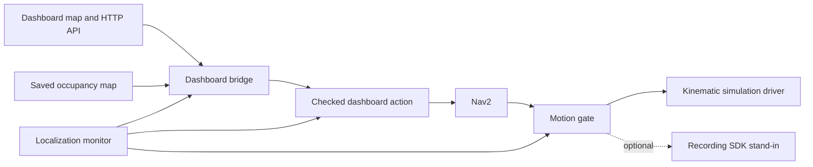

# Dashboard navigation in the simulator

## Watch the map while it is being built

The dashboard can display slam_toolbox's current `/map` and fresh
`map -> base_link` estimates as the simulator maps. This mode streams live
occupancy updates and labels the pose `MAPPING_ESTIMATE`.

Start the dashboard on loopback and create a mission for the live pose.

```bash
PYTHONPATH=src .venv-ros/bin/python -m ultron.dashboard --port 8000 \
  --db runs/live-mapping-dashboard.sqlite --media runs/live-mapping-dashboard-media
```

In another terminal, create the dashboard mission and start mapping.

```bash
curl -X POST http://127.0.0.1:8000/api/missions \
  -H 'Content-Type: application/json' -d '{"mission_id":"LIVE-MAP-01","site_id":"sim"}'
scripts/sim-slam.sh map runs/sim-hall-live-map --dashboard-url http://127.0.0.1:8000
```

Open `http://127.0.0.1:8000`. The mapper saves a versioned map at the end of
the survey. This preview is read-only.

## Navigate while mapping

Start the dashboard with `--goals`, build and source the action overlay as
described below, and start the simulator in live navigation mode. This launch
starts SLAM Toolbox in mapping mode. Nav2's global costmap, the dashboard and
the goal checker all subscribe to the same `/map` stream.

```bash
scripts/sim-slam.sh nav runs/live-navigation --live-map --serve-dashboard \
  --dashboard-url http://127.0.0.1:8000
```

Create a mission and publish the simulation operator heartbeat as shown
below. In the dashboard, choose **Set goal** and click and drag on a mapped
free area. The browser submits the mapping session ID, the displayed grid
stamp and the goal coordinates. The goal checker uses its latest grid and
refuses a source grid more than 2.5 simulated seconds old or a revision it
has not received. It rechecks the target footprint while Nav2 runs and
requests cancellation if the map becomes stale or the target is no longer
known and clear. A localization drop also inhibits motion through the gate.

The simulation test starts with an empty map and supplies the operator
heartbeat automatically.

```bash
scripts/sim-slam.sh nav runs/live-navigation-check --live-map \
  --dashboard-url http://127.0.0.1:8000
```

This test exercises navigation through the dashboard HTTP API and ROS 2.
The simulator provides the recorded ground truth used to score arrival.
[Measured results](SAHIL_VALIDATION.md#dashboard-navigation-on-the-live-slam-grid)

### Use the 3D LiDAR backend in MuJoCo

On the `sahil/3d-slam-nav2` branch, install ROS Humble's
`ros-humble-rtabmap-ros` package and build the action overlay described
below. Start a fresh loopback dashboard with `--goals`.

```bash
scripts/sim-slam.sh nav runs/live-3d-navigation-check --live-map-3d \
  --dashboard-url http://127.0.0.1:8000
```

This case uses ICP odometry from the simulated 3D LiDAR. RTAB-Map publishes
the 3D cloud and its 2D occupancy projection. The dashboard, goal checker
and Nav2 use the projection for single-floor navigation. For manual control,
add `--serve-dashboard`, then create a mission and publish the simulator
operator heartbeat as below. The 3D mode defaults to 0.6× simulation speed
and a 0.28 m/s desired controller speed in the simulated hall.

The automated run saves its checked results in `nav_cases.json`, a
`cloud_map.ply` snapshot and the RTAB-Map database. [3D navigation results](SAHIL_VALIDATION.md#3d-lidar-slam-with-dashboard-navigation-in-mujoco)

To watch the interactive run on a desktop, start the dashboard with
`--goals`, source the action overlay, and add the MuJoCo viewer flag.

```bash
scripts/sim-slam.sh nav runs/live-3d-desktop --live-map-3d --serve-dashboard \
  --viewer --dashboard-url http://127.0.0.1:8000
```

In another terminal, open the RViz2 layout for the fused 3D cloud, live
occupancy projection, TF frames and Nav2 path.

```bash
scripts/sim-slam.sh rviz 3d
```

Open the dashboard, create a mission, and start the simulation operator
heartbeat as shown below. Use **Set goal** on the dashboard to send the
same goal to all three views. Press Esc in MuJoCo or Ctrl-C in the navigation
terminal to stop the simulation.

### Relaunch the three-window desktop demo

On the same checkout, run the original local launcher from the repository root when its output folder and mission ID are unused.

```bash
bash runs/live-3d-desktop-01/launch.sh
```

If the original run already exists, use a fresh run folder.

```bash
demo="live-3d-desktop-$(date +%Y%m%d-%H%M%S)"
mkdir -p "runs/$demo"
sed "s/live-3d-desktop-01/$demo/g" runs/live-3d-desktop-01/launch.sh > "runs/$demo/launch.sh"
bash "runs/$demo/launch.sh"
```

Open the [dashboard](http://127.0.0.1:8000), choose **Set goal**, then click and drag on a clear mapped area. Press Ctrl-C in the launch terminal to stop the demo. On a fresh checkout, use the desktop commands above to start the three views separately.

## Navigate on a checked map

The dashboard uploads a saved occupancy map and the simulator's current valid
localization pose. Its goal bridge sends a map-scoped ROS action to the checked
navigation adapter. The adapter verifies the frame, map ID and version, fresh
operator enable, current localization and the target footprint before handing
the goal to Nav2. Nav2 velocities reach the simulated driver through the motion
gate.



The dashboard has no user authentication. The commands below use loopback
HTTP and the isolated simulation ROS domain. Physical B2 setup and operation
have separate requirements. [Hardware readiness](HARDWARE_READINESS.md)

## Build the action interface

Use a ROS 2 Humble shell with `colcon` and the simulation dependencies installed.

```bash
source /opt/ros/humble/setup.bash
colcon --log-base runs/ros-nav-interfaces/log build \
  --base-paths adapters/ros2/ultron_nav_interfaces \
  --build-base runs/ros-nav-interfaces/build \
  --install-base runs/ros-nav-interfaces/install
source runs/ros-nav-interfaces/install/local_setup.bash
```

Use `scripts/setup-ros-venv.sh` for the ROS virtual environment. The dashboard
process needs the `dashboard` extra. The build output stays under `runs/`.

## Run the simulator and dashboard

In terminal 1, start a dashboard with goals enabled.

```bash
PYTHONPATH=src .venv-ros/bin/python -m ultron.dashboard --goals --port 8000 \
  --db runs/nav-dashboard.sqlite --media runs/nav-dashboard-media
```

In terminal 2, source the action overlay and load a map from the simulation.
If needed, first create one with `scripts/sim-slam.sh map runs/sim-hall-map`.
For an existing map, pass its mapping-run folder to `--map`.

```bash
source /opt/ros/humble/setup.bash
source runs/ros-nav-interfaces/install/local_setup.bash
scripts/sim-slam.sh nav runs/nav-dashboard-live --map runs/sim-hall-map \
  --serve-dashboard --dashboard-url http://127.0.0.1:8000
```

Start a dashboard mission so the live page shows the robot pose.

```bash
curl -X POST http://127.0.0.1:8000/api/missions \
  -H 'Content-Type: application/json' -d '{"mission_id":"NAV-01","site_id":"sim"}'
```

In a third terminal, publish the simulation operator heartbeat while you
intend to allow command dispatch. Ctrl-C stops the heartbeat, and the gate
inhibits command forwarding when it expires.

```bash
scripts/sim-slam.sh exec ros2 topic pub -r 5 /ultron/sim/operator_enable \
  std_msgs/msg/Bool '{data: true}'
```

Open the dashboard at `http://127.0.0.1:8000` and select **Set goal**. Click
the map and drag to choose the heading. For scripted testing, send
`POST /api/goal` with `{"x": 3.0, "y": 1.0, "yaw": 1.57}` and read
`GET /api/goal`. Coordinates are in metres in the `map` frame. Yaw is
counterclockwise from +x, in radians. HTTP callers can supply `map_id` and
`map_version` explicitly. The dashboard binds requests that omit both to the
current displayed map.

| Status | Meaning |
|---|---|
| `SENT` | The dashboard queued the request. |
| `ACCEPTED` | The checked action passed its preconditions and dispatched to Nav2. |
| `REJECTED` | A precondition failed. `detail` carries the reason. |
| `SUCCEEDED` | Nav2 reported arrival in the simulation. |
| `FAILED` | Navigation failed or the action was unavailable. |
| `CANCELED` | Cancellation completed. A replacement waits for the previous goal to finish before dispatch. |

## Run the automated check

Start a fresh local dashboard with goals enabled, then run this command from
the same ROS Humble setup used above. The test creates its own mission and
publishes a simulation operator heartbeat.

```bash
scripts/sim-slam.sh nav runs/nav-dashboard-check --map runs/sim-hall-map \
  --cases dashboard,operator_inhibit --dashboard-url http://127.0.0.1:8000 \
  --sdk-stand-in
```

The SDK wrapper is optional and starts only with `--sdk-stand-in` or an
explicit `--stand-in-log`. Its input is `/ultron/sim/cmd_vel`, the motion
gate's output. The stand-in records `Move` and `StopMove` calls, including a
shutdown stop. The wrapper clamps forward and yaw speed to the simulation
limits, rejects unsupported axes, and uses a steady-clock 250 ms timeout for
missing commands. SDK errors latch inhibition and failed stops are retried
while the process is running. An independently supervised stop remains a
hardware prerequisite. [Pinned Unitree B2 SportClient source](https://github.com/unitreerobotics/unitree_sdk2_python/blob/814556d15970dd2ecf1c9984e845ca02ab07e206/unitree_sdk2py/b2/sport/sport_client.py#L125)

Look for `nav_cases.json`, `dashboard_bridge.log`, `gate.json` and
`sdk_stand_in.jsonl` in the run folder. [Measured validation](SAHIL_VALIDATION.md)
