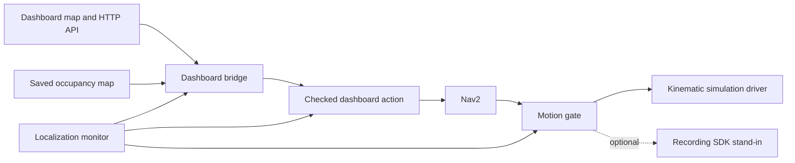

# Dashboard navigation in the simulator

## Watch the map while it is being built

The dashboard can display slam_toolbox's current `/map` and fresh
`map -> base_link` estimates as the simulator maps. This mode streams live
occupancy updates and labels the pose `MAPPING_ESTIMATE`.

Start the dashboard on loopback and create a mission for the live pose.

```bash
PYTHONPATH=src .venv-ros/bin/python -m ultron.dashboard --port 8000 \
  --db runs/live-mapping-dashboard.sqlite --media runs/live-mapping-dashboard-media
```

In another terminal, create the dashboard mission and start mapping.

```bash
curl -X POST http://127.0.0.1:8000/api/missions \
  -H 'Content-Type: application/json' -d '{"mission_id":"LIVE-MAP-01","site_id":"sim"}'
scripts/sim-slam.sh map runs/sim-hall-live-map --dashboard-url http://127.0.0.1:8000
```

Open `http://127.0.0.1:8000`. The mapper saves a versioned map at the end of
the survey. The live preview has no navigation authority. Checked goals use
the saved map workflow below. Navigation during mapping would require the
goal checker and Nav2 to consume the same occupancy revision and a policy for
revalidating goals when loop closure shifts the map.

## Navigate on a checked map

The dashboard uploads a saved occupancy map and the simulator's current valid
localization pose. Its goal bridge sends a map-scoped ROS action to the checked
navigation adapter. The adapter verifies the frame, map ID and version, fresh
operator enable, current localization and the target footprint before handing
the goal to Nav2. Nav2 velocities reach the simulated driver through the motion
gate.



The dashboard has no user authentication. The commands below use loopback
HTTP and the isolated simulation ROS domain. Physical B2 setup and operation
have separate requirements. [Hardware readiness](HARDWARE_READINESS.md)

## Build the action interface

Use a ROS 2 Humble shell with `colcon` and the simulation dependencies installed.

```bash
source /opt/ros/humble/setup.bash
colcon --log-base runs/ros-nav-interfaces/log build \
  --base-paths adapters/ros2/ultron_nav_interfaces \
  --build-base runs/ros-nav-interfaces/build \
  --install-base runs/ros-nav-interfaces/install
source runs/ros-nav-interfaces/install/local_setup.bash
```

Use `scripts/setup-ros-venv.sh` for the ROS virtual environment. The dashboard
process needs the `dashboard` extra. The build output stays under `runs/`.

## Run the simulator and dashboard

In terminal 1, start a dashboard with goals enabled.

```bash
PYTHONPATH=src .venv-ros/bin/python -m ultron.dashboard --goals --port 8000 \
  --db runs/nav-dashboard.sqlite --media runs/nav-dashboard-media
```

In terminal 2, source the action overlay and load a map from the simulation.
If needed, first create one with `scripts/sim-slam.sh map runs/sim-hall-map`.
For an existing map, pass its mapping-run folder to `--map`.

```bash
source /opt/ros/humble/setup.bash
source runs/ros-nav-interfaces/install/local_setup.bash
scripts/sim-slam.sh nav runs/nav-dashboard-live --map runs/sim-hall-map \
  --serve-dashboard --dashboard-url http://127.0.0.1:8000
```

Start a dashboard mission so the live page shows the robot pose.

```bash
curl -X POST http://127.0.0.1:8000/api/missions \
  -H 'Content-Type: application/json' -d '{"mission_id":"NAV-01","site_id":"sim"}'
```

In a third terminal, publish the simulation operator heartbeat while you
intend to allow command dispatch. Ctrl-C stops the heartbeat, and the gate
inhibits command forwarding when it expires.

```bash
scripts/sim-slam.sh exec ros2 topic pub -r 5 /ultron/sim/operator_enable \
  std_msgs/msg/Bool '{data: true}'
```

Open the dashboard at `http://127.0.0.1:8000` and select **Set goal**. Click
the map and drag to choose the heading. For scripted testing, send
`POST /api/goal` with `{"x": 3.0, "y": 1.0, "yaw": 1.57}` and read
`GET /api/goal`. Coordinates are in metres in the `map` frame. Yaw is
counterclockwise from +x, in radians. HTTP callers can supply `map_id` and
`map_version` explicitly. The dashboard binds requests that omit both to the
current displayed map.

| Status | Meaning |
|---|---|
| `SENT` | The dashboard queued the request. |
| `ACCEPTED` | The checked action passed its preconditions and dispatched to Nav2. |
| `REJECTED` | A precondition failed. `detail` carries the reason. |
| `SUCCEEDED` | Nav2 reported arrival in the simulation. |
| `FAILED` | Navigation failed or the action was unavailable. |
| `CANCELED` | Cancellation completed. A replacement waits for the previous goal to finish before dispatch. |

## Run the automated check

Start a fresh local dashboard with goals enabled, then run this command from
the same ROS Humble setup used above. The test creates its own mission and
publishes a simulation operator heartbeat.

```bash
scripts/sim-slam.sh nav runs/nav-dashboard-check --map runs/sim-hall-map \
  --cases dashboard,operator_inhibit --dashboard-url http://127.0.0.1:8000 \
  --sdk-stand-in
```

The SDK wrapper is optional and starts only with `--sdk-stand-in` or an
explicit `--stand-in-log`. Its input is `/ultron/sim/cmd_vel`, the motion
gate's output. The stand-in records `Move` and `StopMove` calls, including a
shutdown stop. The wrapper clamps forward and yaw speed to the simulation
limits, rejects unsupported axes, and uses a steady-clock 250 ms timeout for
missing commands. SDK errors latch inhibition and failed stops are retried
while the process is running. An independently supervised stop remains a
hardware prerequisite. [Pinned Unitree B2 SportClient source](https://github.com/unitreerobotics/unitree_sdk2_python/blob/814556d15970dd2ecf1c9984e845ca02ab07e206/unitree_sdk2py/b2/sport/sport_client.py#L125)

Look for `nav_cases.json`, `dashboard_bridge.log`, `gate.json` and
`sdk_stand_in.jsonl` in the run folder. [Measured validation](SAHIL_VALIDATION.md)
